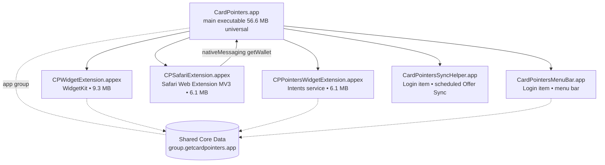

# Phase 2 — Application Inventory

Target: `/Volumes/SamsungT7/Applications/cardpointers/CardPointers.app` (47 MB)

## 1. Metadata

| Field | Value |
|---|---|
| Display name | CardPointers |
| Bundle ID | `com.getcardpointers.app` |
| Version | 8.1.4 |
| Build | 20261019 |
| Platform | Mac Catalyst (`UIDeviceFamily = [2]`, iOSSupport frameworks) — the iPad app built for macOS |
| Minimum macOS | 12.0 |
| Built with | Xcode 27.1 (27A9275), SDK macosx27.0 |
| Category | `public.app-category.finance` |
| URL scheme | `cardpointers://` |
| Universal Links | `applinks:cardpointers.com`, `applinks:getcardpointers.com` (+ appclips, webcredentials) |
| Distribution | Mac App Store (`_MASReceipt` present) |
| Team ID | `489M9V6472` |

## 2. Code signing

| Property | Value |
|---|---|
| Authority chain | Apple Mac OS Application Signing → Apple WWDR CA → Apple Root CA |
| CodeDirectory | v20500, flags `0x10000(runtime)` → **Hardened Runtime** |
| Hash | SHA-256, CDHash `3b3ae4d48d84b385002a803025b140e8decea7c6` |
| Sealed resources | 93 files, 13 rules |

## 3. Entitlements (main app)

| Entitlement | Value | Meaning |
|---|---|---|
| `com.apple.security.app-sandbox` | true | Sandboxed |
| `com.apple.security.network.client` | true | Outbound network |
| `com.apple.security.application-groups` | `group.com.emcro.CardPointers`, `group.getcardpointers.app` | Shared Core Data store with widgets/extensions/helpers |
| `keychain-access-groups` | `489M9V6472.com.getcardpointers.app` | Auth token storage |
| `aps-environment` | production | Push notifications |
| `com.apple.developer.applesignin` | Default | Sign in with Apple |
| `com.apple.developer.associated-domains` | applinks/webcredentials/appclips for cardpointers.com | Universal links + passkeys |
| `com.apple.developer.financekit` | financial-data | FinanceKit (Apple Card / Wallet balances) |
| `com.apple.developer.pass-type-identifiers` | `489M9V6472.*` | Wallet passes (card previews) |
| `com.apple.developer.carplay-driving-task` | true | CarPlay "best card nearby" |
| `com.apple.developer.private-cloud-compute` | true | Apple Intelligence PCC models |
| `com.apple.developer.shared-with-you` | true | Shared-with-You shelf |
| `com.apple.developer.usernotifications.time-sensitive` | true | Expiring-offer alerts |
| `com.apple.security.personal-information.location` | true | Nearby merchants |
| `com.apple.security.personal-information.photos-library` | true | Save card previews |

## 4. Privacy usage strings (Info.plist)

- **Camera:** "Take photos to add cards … or view pointers in Augmented Reality."
- **FinancialData:** "Automatically sync cards and renewal dates."
- **Location (When In Use / Always):** "View nearby stores and receive location-based reminders…"
- **Photo Library Add:** "Save card previews…"
- Background modes: `fetch`, `location`, `processing`, `remote-notification`
- BGTask IDs: `com.getcardpointers.app.offer-sync.refresh`, `com.getcardpointers.app.offer-sync.continued.*`

Privacy manifest (`PrivacyInfo.xcprivacy`): collects Email, User ID (App Functionality), Other User Content (Personalization, Functionality); accesses UserDefaults (reason `1C8F.1`, app-group sharing).

## 5. Executables, plugins, extensions

| Bundle | Identifier | Type | Principal |
|---|---|---|---|
| CardPointers | `com.getcardpointers.app` | App (Catalyst) | `CardPointers.MainApp` (SwiftUI) |
| CPWidgetExtension | `com.getcardpointers.app.CardPointersWidget` | `com.apple.widgetkit-extension` | — |
| CPPointersWidgetExtension | `com.getcardpointers.app.PointersWidgetExtension` | `com.apple.intents-service` | `CPPointersWidgetExtension.IntentHandler` |
| CPSafariExtension | `com.getcardpointers.app.Safari-Extension` | `com.apple.Safari.web-extension` | `SafariWebExtensionHandler` |
| CardPointersMenuBar | `com.getcardpointers.app.MenuBarHelper` | LoginItem app | — |
| CardPointersSyncHelper | `com.getcardpointers.app.OfferSyncHelper` | LoginItem app | — |

All binaries are universal (x86_64 + arm64).

## 6. Embedded third-party frameworks (statically linked, SPM)

| Library | Evidence | Purpose |
|---|---|---|
| RevenueCat + RevenueCatUI | 923 + 441 Swift types, `RevenueCat_*.bundle`, `api.revenuecat.com` | Subscriptions / paywalls / StoreKit 2 |
| PostHog (+ PLCrashReporter, libwebp) | 229 types, `us.i.posthog.com` | Product analytics, session replay, crash reports |
| protobuf-c | `PROTOBUF_C__MESSAGE_DESCRIPTOR_MAGIC` strings | Used by PLCrashReporter |

No embedded `.framework` directories — everything is statically linked.

## 7. Resource inventory (summary — see resources.md)

| Resource | Notes |
|---|---|
| `Assets.car` | 127 renditions / 82 named assets (alt app icons, bank logos, colors CPBlue/CPink/CPWhite) |
| `coredata.momd` | 24-entity Core Data model (see storage.md) |
| `cp_seed.sqlite` | 4.1 MB pre-populated catalog: 684 banks, 3,429 cards, 4,212 earnings, 8,355 features, 18 categories, 3,706 merchants, 3,708 hosts |
| Bank JS (`amex-*.js`, `*Functions.js`, `offer-bank-bootstrap.js`) | 717 KB obfuscated scripts for Offer Sync automation |
| `Metadata.appintents` | 70 App Intents, 22 entities, 20 queries, 10 App Shortcuts |
| `*.watchface` (5) | Shareable Apple Watch faces with complications |
| `Settings.bundle` | Version, Build, Identifier, Reset App |
| `Heartbeats.ahap` | Haptic pattern |
| `Base.lproj/*.intentdefinition` | Legacy SiriKit widget intents |

Localization: `en` (development region) only.
