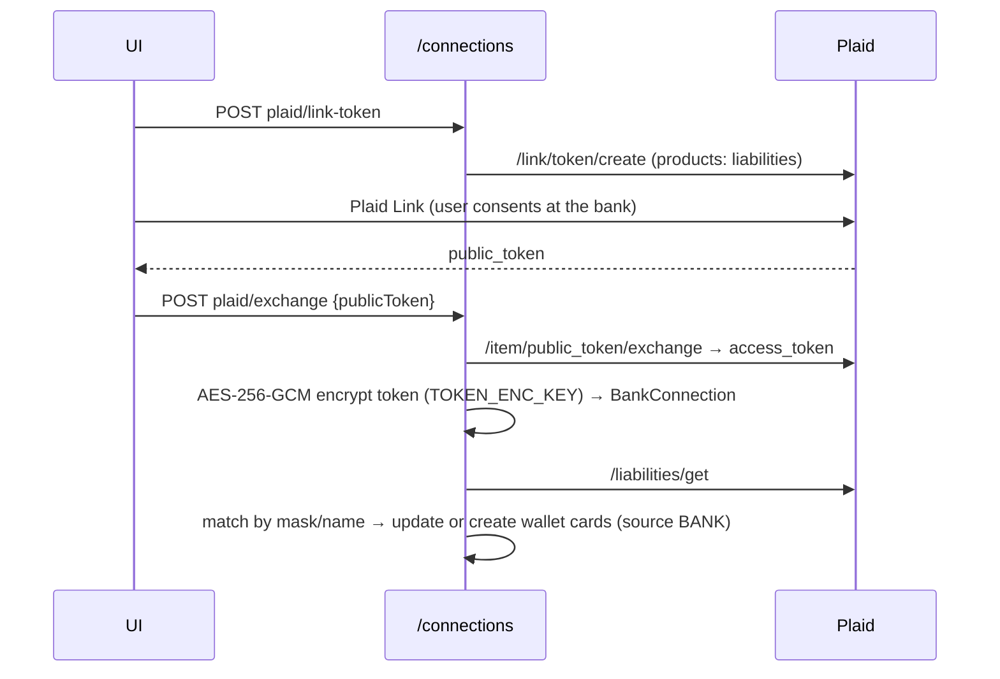

# Bank & Credit-Bureau Integration Feasibility

Status date: 2026-11-21. Implementation: `backend/src/portfolio/connections.ts` (BankConnector + Plaid), `backend/src/portfolio/credit-reports.ts`.

## 1. Direct issuer connections

None of the requested institutions (Chase, Bank of America, Citi, American Express, Barclays, Capital One, Discover, PenFed, Wells Fargo, U.S. Bank, FNBO, Synchrony, Navy Federal, Goldman Sachs, Elan Financial) publishes a consumer-facing account API for third-party apps. Their data-sharing programs (e.g. Chase's, Wells Fargo's, Capital One's FDX-based APIs) are available **only to approved aggregators and partners** under contract.

**Conclusion:** use an aggregator. Do not scrape bank websites with stored credentials (terms-of-service violation, credential liability, brittle).

## 2. Aggregators

| Provider | Access | Credit-card data | Not available | Notes |
|---|---|---|---|---|
| **Plaid** (implemented) | Free sandbox; production needs application + contract; per-item pricing | `/liabilities/get`: account name/official name, mask (last 4), credit limit, balances, APR, statement data | Open date, annual fee, authorized users, product id | OAuth to most large issuers; Link UI (hosted) for consent |
| MX | Contract | Accounts, balances, limits | Same gaps | Strong with credit unions |
| Finicity / Mastercard Open Finance | Contract | Accounts, balances | Same gaps | |
| Akoya | Contract (bank-owned network) | FDX accounts | Same gaps | Tokenised, no screen scraping |

Plaid coverage of the requested list is broad (all major issuers via OAuth or API; credit unions variable). Coverage must be re-verified per institution in production.

### Implemented flow

- Sandbox shortcut: `POST /connections/plaid/sandbox` creates a test item without Link (sandbox only).
- Nightly `sync-bank-connections` job re-syncs every connection.
- Disabled unless `BANK_PROVIDER=plaid` and `PLAID_CLIENT_ID`/`PLAID_SECRET` are set; endpoints then return 503.
- **Production gap:** the Plaid Link JavaScript widget (cdn.plaid.com) is not embedded yet — it needs a CSP exception for `cdn.plaid.com` and the production contract.

## 3. Credit bureaus

| Source | APIs | Authentication | Data elements | Limitations | Verdict |
|---|---|---|---|---|---|
| **Credit Karma** (TransUnion/Equifax data) | None public | Consumer login only | Tradelines incl. open dates (in its UI) | Terms prohibit automated access; no partner API for this use | **Not feasible** |
| **Experian** | Experian Connect / partner credit-report APIs (B2B) | Business agreement, OAuth client credentials, consumer identity verification and consent | Tradelines: creditor, account type, open date (month), status, limit, AU/individual flag, payment history | FCRA permissible purpose and compliance review; per-pull pricing; data must be handled as consumer-report information | Feasible only with a partnership |
| Equifax / TransUnion | Similar B2B programs | Same | Same | Same | Same as Experian |
| **annualcreditreport.com** (consumer) | None (PDF/HTML for the consumer) | — | All tradelines with open month | Manual | **Implemented as manual entry** |

### Implemented alternative

`/credit-reports/accounts`: the user transcribes tradelines (creditor, last digits, opened month, AU, status, limit, bureau). Each entry is auto-matched to a wallet card (last digits + issuer/name similarity); **Use this date** copies the open month (precision MONTH), AU flag, status and limit onto the card, feeding the 5/24 engine. `GET /credit-reports/providers` exposes the feasibility status above to the UI.

## 4. Data handling

| Data | Storage | Protection |
|---|---|---|
| Aggregator access token | `BankConnection.accessTokenEnc` | AES-256-GCM, random IV, key from `TOKEN_ENC_KEY`; never returned by the API |
| Account mask | `WalletCard.lastFour` | 4–5 digits only |
| Tradeline entries | `CreditReportAccount` | Owner-scoped; deleted with the user |
| Raw provider responses | not stored | only mapped fields + `sourceMeta` (provider, account id, sync time) |
