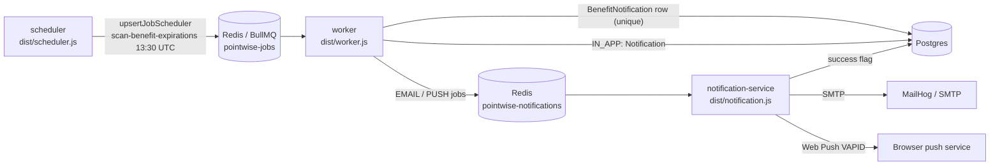

# Benefit Notification System

Source: `backend/src/jobs/jobs.service.ts` (`scanBenefitExpirations`), `backend/src/notifications/delivery.ts`, `backend/src/domain/benefits.ts` (`alertThresholds`, `dueThreshold`) · Processes: `worker`, `scheduler`, `notification-service` · Tests: INT `benefit expiration alerts`, unit `delivery.spec.ts`, CY-BEN-02, `tests/test-cases/benefits/`.

## 1. Lead times (scaled to the period)

| Period | Alerts (days before the period ends) |
|---|---|
| Monthly | 7, 1 |
| Quarterly | 30, 7, 1 |
| Semi-annual | 60, 30, 7, 1 |
| Annual / multi-year | 90, 60, 30, 7, 1 |

The requested fixed 90/60/30/7/1 schedule applies to annual credits; shorter periods use the subset that fits inside the period. Only benefits with value **remaining** in the current period, on **open** cards, that are **enabled**, are alerted. If a run was missed, only the smallest threshold already crossed is sent (no burst of stale alerts).

## 2. Architecture

## 3. Idempotency & delivery

| Mechanism | Detail |
|---|---|
| Delivery log | `BenefitNotification (userBenefitId, periodEnd, thresholdDays, channel)` is **unique**; the job inserts first and skips on conflict → re-runs never duplicate |
| In-app | `Notification` type `BENEFIT_EXPIRING`, dedupe key `benefit:<id>:<periodEnd>:<threshold>`; `emailedAt` pre-set when the email channel is on so the daily digest doesn't repeat it |
| Email / push | queued with 3 attempts and exponential backoff (30 s base); failed email throws → BullMQ retries; result recorded in `BenefitNotification.success` |
| Push hygiene | 404/410 responses delete the subscription; endpoints limited to browser push services (FCM, Mozilla, WNS, Apple) — SSRF guard |

## 4. Channels & preferences

| Preference | Default | Effect |
|---|---|---|
| `benefitExpiring` | on | master switch (users without a preferences row get defaults) |
| `benefitEmail` | on | email channel |
| `benefitPush` | off | set when the user enables push in Settings (needs `VAPID_*` keys) |

## 5. Schedules (UTC)

| Job | Cron | Purpose |
|---|---|---|
| `scan-benefit-expirations` | `30 13 * * *` | benefit alerts |
| `snapshot-524` | `15 0 * * *` | daily 5/24 history |
| `sync-bank-connections` | `0 6 * * *` | aggregator re-sync |
| existing | see backend-spec §5 | offers, renewals, bonus deadlines, digests |

The scheduler also removes schedulers that are no longer defined and re-asserts the schedule hourly. Admins can run any job synchronously: `POST /api/v1/admin/jobs/<name>/run`.
