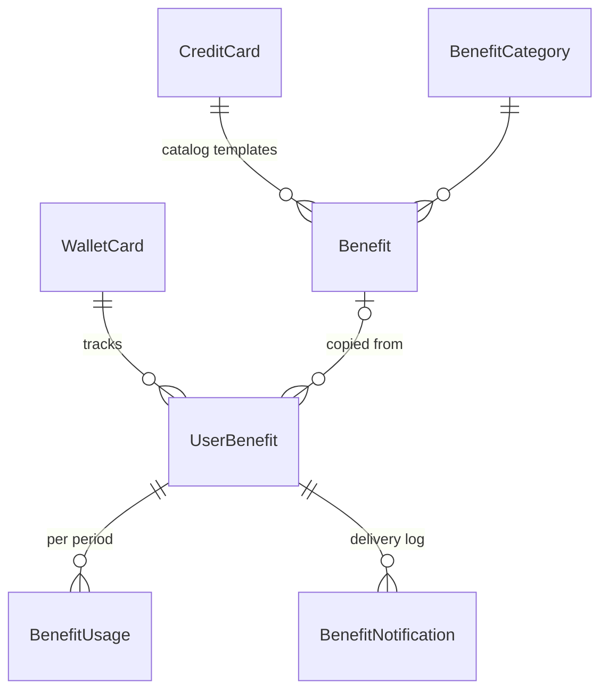

# Benefits Data Model & Utilization Tracker

Source: `backend/src/domain/benefits.ts` (pure), `backend/src/portfolio/benefits.ts` (API) · UI: `/benefits` · Tests: `test/unit/benefits/`, INT `benefits CRUD and usage`, `tests/test-cases/benefits/`.

## 1. Normalised model (from the tracker spreadsheet's columns)

| Spreadsheet column | Model |
|---|---|
| Card | `UserBenefit.walletCardId` → `WalletCard` → `CreditCard` |
| Benefit | `name` (+ `BenefitCategory` via keyword rules, `kind`) |
| Credit value per card ($/yr) | `amountPerPeriodCents` = annual × periodMonths / 12 |
| How it's issued | `howIssued` |
| Resets | `period` + `periodMonths` + `basis` |
| Action needed / Notes | `actionNeeded` / `notes` |
| Used so far / Remaining | `BenefitUsage` rows per period → computed |
| # Cards, Mine / Spouse's | one `UserBenefit` per holder's wallet card |
| Total value, Credits minus fee | computed (`annualValueCents`, portfolio net value) |

| Entity | Key fields |
|---|---|
| `BenefitCategory` | slug (airline, hotel, dining, rideshare, trusted-traveler, clear, lounge, free-night, entertainment, membership, shopping, other) |
| `Benefit` (template) | cardId, name (unique per card), kind (CREDIT/CERTIFICATE/MEMBERSHIP/ACCESS), period, periodMonths, basis, amountPerPeriodCents |
| `UserBenefit` | walletCardId, benefitId?, the same schedule fields (editable copy), enabled; unique (walletCard, name) |
| `BenefitUsage` | userBenefitId, periodStart, amountCents, usedOn, note |

Adding a card to the wallet copies its catalog templates (`trackBenefits: false` opts out).

## 2. Periods

| period | months | CALENDAR windows | CARDMEMBER_YEAR windows |
|---|---|---|---|
| MONTHLY | 1 | calendar months | months from the open day |
| QUARTERLY | 3 | Jan/Apr/Jul/Oct | 3-month steps from the open day |
| SEMIANNUAL | 6 | Jan–Jun, Jul–Dec | 6-month steps from the open day |
| ANNUAL | 12 | calendar year | anniversary to anniversary |
| MULTI_YEAR | e.g. 48 | — (always anchored to the open date) | 4-year windows |

Ends are exclusive; the last usable day is `end − 1 day`. Month-end/leap anchors clamp (Jan 31 → Feb 28). Without an open date, cardmember benefits fall back to calendar windows. **Annual resets need no job** — the current window is computed from the date.

## 3. Utilization

For the current period: allocated, used, remaining, % used, days left, status:

| Status | Condition |
|---|---|
| COMPLETED | remaining = 0 (zero-value perks such as lounge access are always complete) |
| EXPIRED | period ended with value remaining (past periods → "missed") |
| EXPIRING_SOON | ≤ 30 days left (configurable `expiringDays`) |
| PARTIAL | some used |
| UNUSED | nothing used |

Year view (`benefitYearSummary`): used this year, remaining this year, **missed** (unused value of periods that already ended). Usage beyond a period's remaining value is refused (400); usage dates can't be in the future.

## 4. Dashboard buckets (`GET /benefits/summary`)

available (UNUSED/PARTIAL) · expiring (EXPIRING_SOON) · completed · missed (benefits with missed value this year) · totals (annual value, used, remaining, missed, current remaining). Closed cards and disabled benefits are excluded.

## 5. API

| Method | Path |
|---|---|
| GET | `/benefits` (`profileId`, `walletCardId`, `status`, `expiringDays`) · `/benefits/summary` · `/benefits/catalog?cardId=` · `/benefits/categories` |
| POST | `/benefits` (template or custom) · `/benefits/apply-templates/:walletCardId` · `/benefits/:id/usage` |
| PATCH / DELETE | `/benefits/:id` · DELETE `/benefits/:id/usage/:usageId` |

## Account-level detection and audit (Phase: benefit audit)

- Tracking is per **card account**: `UserBenefit.walletCardId`. Product, cardholder (`WalletCard.profileId` → household `Profile`) and household totals are sums of account rows (`domain/benefit-roll.ts`). Two cards of one product never share usage, credits or renewal dates.
- `BenefitPeriod` now includes `ONE_TIME` and `CUSTOM`; anniversary year is `ANNUAL` + `CARDMEMBER_YEAR`. `UserBenefit.expiresOn`, `windowStart`, `windowEnd` describe expiring and one-time benefits.
- `BenefitUsage` carries `detectionMethod` (MANUAL, EXACT, ALIAS, REGEX, FUZZY, AI), `confidence` (0-100), `verification` (UNVERIFIED, VERIFIED, REJECTED), `statementImportId` and `evidence` ({merchant, rule, line}).
- `BenefitDetection` is the audit row per (benefit, transaction): method, confidence, rule, tier (ASSIGN ≥ 85, REVIEW 60-84), AI reasoning, duplicate risk, and the user's decision (DETECTED, ACCEPTED, REJECTED).
- `StatementValidation` stores one completeness report per imported statement.
- Detection pipeline: normalize → exact → alias → regex → fuzzy → (opt-in AI, merchant name only, confidence ≤ 75) → score → assign. See `docs/amex-parser-review.md`.
- The workbook analysis is in `docs/usage-tab-analysis.md` and `docs/benefit-tab-analysis.md`.
