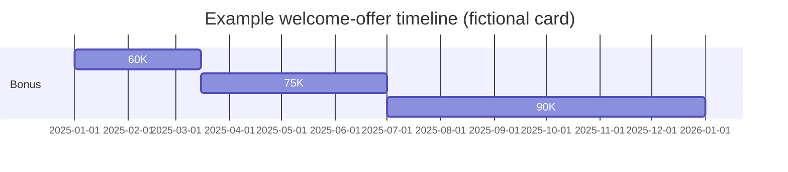

# Card Offer History

Status: **built (2026-11-24)** — `CardOffer` table, `CardRefreshService.recordOfferVersion/history/welcomeBonuses/annualFees`, public APIs, admin timeline, assistant tool `get_card_offer_history` (public data). Feeds analytics such as "Gold card: 60K → 75K → 90K".

## 1. Model — versioned offers (slowly changing dimension, type 2)

| Field | Meaning |
|---|---|
| `id` | version id |
| `cardId` | catalog card |
| `kind` | WELCOME / LIMITED_TIME / ELEVATED / RETENTION_TYPICAL |
| `bonusType`, `bonusAmount` | e.g. POINTS 90 000 |
| `minSpendCents`, `spendMonths` | requirement |
| `annualFeeCents`, `firstYearFeeWaived` | fee at the time |
| `valuationCents` | bonus value at the valuation in force |
| `validFrom`, `validTo` | `validTo = null` → current version |
| `source` | proposal id / source URL / admin |
| `changeNote` | short human note |

Rules: exactly one open version per (card, kind) — enforced by a partial unique index `WHERE "validTo" IS NULL`; approving a changed offer closes the open version (`validTo = now`) and inserts the new one in the same transaction; history is append-only (corrections create a new version with a note).

## 2. Queries
- **Timeline:** `SELECT bonusAmount, validFrom, validTo FROM CardOffer WHERE cardId=$1 AND kind='WELCOME' ORDER BY validFrom` → "60K (Jan–Mar) → 75K (Mar–Jul) → 90K (since Jul)".
- **Is today's offer good?** current vs max/median of the last 24 months → "best in 2 years" / "below typical".
- **Elevated offer alerts:** when a new version's bonus value exceeds the 24-month median by ≥ 20 %, notify users who track that card or match an offer alert (reuses the notification system).

## 3. API
`GET /cards/:idOrSlug/offer-history` (versions + timeline label), `GET /welcome-bonuses?elevated=true` (current offers, value, 24-month median, elevated), `GET /annual-fees` (current fee, previous fee, change date) — all public. Retention offers: `POST /me/retention-offers`, `GET /cards/:idOrSlug/retention-offers` (aggregated, reporter never shown). Elevated versions notify users whose offer-alert keywords match the card or issuer (one notification per version).

## 4. Tests
Version close/open in one transaction plus the partial unique index `CardOffer_one_open_version`; timelines ("40K → 50K → 60K → 90K" in the integration test); elevated detection (unit thresholds + integration notification); annual-fee change tracking. Seed: every catalog card gets an opening version; Contoso Gold has a fictional 40K → 50K → 60K history.

## 5. Position in history, expiry advice and the dashboard (2026-11-25)
`domain/offer-intel.ts` (pure, thresholds in `OFFER_CONFIG`) turns the version history into: **best-ever** value and since when, 24-month typical, time-weighted **percentile**, a **verdict** (BEST_EVER / NEAR_HIGH ≥ 90 % of best / ELEVATED ≥ 1.2× typical / TYPICAL / BELOW_TYPICAL < 0.9× / UNKNOWN) and plain-language **advice** ("Apply within 9 days before this elevated offer expires.", "Current offer is near its historic high.", "Offer likely worth prioritizing.", "Wait for a better offer; this card has been worth up to $1,400.", "Move the application to Spouse."). `GET /welcome-bonuses` carries these fields (public); `GET /offers/market` (signed in) adds, per offer, your eligibility, 5/24 impact, first-year and long-term value, approval odds and **application difficulty**, plus sections for upcoming expirations, historical highs and a recommended offer. UI: `/offers/market`.

**Application difficulty** (`ISSUER_RULES`) uses community-reported velocity rules (5/24, 6/24, 1/8 and 2/65, 1-in-5-days, …). They are labelled *community-reported* until confirmed from an issuer's own wording (`offer-sources-research.md`), and an unverified rule can raise difficulty to HARD at most, never BLOCKED.

**Automatic refresh (ADR-003).** The scheduled `refresh-card-sources` job fetches registered issuer pages and passes each proposed change through `autoPublishDecision`: published automatically only if read from the issuer's own allow-listed domain, for a known card, with extraction confidence ≥ 0.8, inside plausibility bounds and a change ≤ 60 %; otherwise it stays a pending proposal. Auto-published changes are written to `AuditLog` with `auto: true`, reasons and source. Admin-triggered refreshes always only propose. Switch off with `OFFER_AUTO_PUBLISH=false`.
