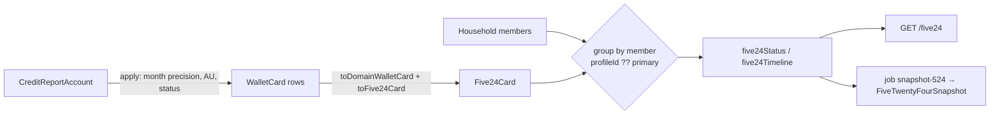

# Chase 5/24 Engine

Source: `backend/src/domain/five24.ts` (pure) · API: `GET /api/v1/five24` · UI: `/five24` · Tests: `backend/test/unit/524/five24.spec.ts`, `test/integration/portfolio.int-spec.ts`, `tests/test-cases/524/`.

## 1. Rule

A person is **N/24**, where N = credit-card accounts opened in the last 24 months that appear on that person's **personal** credit report. Many issuers (notably Chase) deny most new cards at 5/24 or above.

| Account | Counts? | `reason` |
|---|---|---|
| Personal card, open or closed | ✅ | `PERSONAL` |
| Authorized-user card (on the AU's report) | ✅ (unless manually excluded) | `AUTHORIZED_USER` |
| Business card, issuer reports to personal bureaus (`Issuer.businessReportsToPersonal`; e.g. Capital One, Discover, TD) | ✅ | `BUSINESS_REPORTS_TO_PERSONAL` |
| Business card, other issuers | ❌ | `BUSINESS_NOT_REPORTED` |
| Application pending / denied | ❌ | `NOT_OPENED` |
| Opened ≥ 24 months ago | ❌ | `OUTSIDE_WINDOW` |
| Manually excluded (e.g. AU card removed on reconsideration) | ❌ | `MANUAL_EXCLUSION` (+ note) |
| No open date | ❓ listed in `unknown` (count may be understated) | `NO_OPEN_DATE` |
| Open date in the future | ❌ | `FUTURE_DATE` |

## 2. Dates

| Stored | Drop-off (first instant it no longer counts) |
|---|---|
| `openDatePrecision = DAY` | `openedAt + 24 months` (month-end clamped: Feb 29 → Feb 28) |
| `openDatePrecision = MONTH` (credit reports, spreadsheets with "2024-07") | 1st day of the **25th** month after the opening month — conservative: the card is assumed to count through its whole 24th month |

The boundary is exclusive: a card opened exactly 24 months ago (same instant) no longer counts.

## 3. Outputs

```ts
five24Status(cards, now, limit = 5) → {
  count, limit, label,          // "0/24" … "5/24", "6/24+"
  underLimit, slotsAvailable,   // max(0, limit − count)
  nextDropAt,                   // earliest drop-off among counted cards
  nextSlotAt,                   // date the person is next under the limit: the (count − limit + 1)-th drop
  contributing[], excluded[], unknown[]   // per card: reason, openedAt, dropsOffAt, note
}
five24Timeline(cards, now, horizonMonths = 24) → [{ date, count, label, event: NOW|DROP }]   // same-day drops merged
```

## 4. Flow



## 5. Data sources for open dates

| Source | Open date? |
|---|---|
| Manual entry (wallet) | ✅ day |
| Spreadsheet/CSV import | ✅ day or month (detected from format) |
| Credit-report tradeline (manual entry, auto-matched by last digits) | ✅ month |
| Bank aggregator (Plaid) | ❌ — cards land in `unknown` until a date is added |

## 6. Dashboard

The `/five24` page shows, per household member: gauge (green < 5, red ≥ 5), "Under 5/24 on" date, counted cards with "counts until", not-counted cards with reasons, a step-chart projection, and a credit-report entry form. The existing dashboard tile uses the same engine (`insights.fiveTwentyFour` delegates to it).

## 7. Traceability

| Spec item | Implementation | Test |
|---|---|---|
| Count personal accounts in 24 months | `evaluateCard`, `five24Status` | U: "counts a personal card…", boundary tests |
| Store open date, issuer, personal/business, included/excluded | `WalletCard.approvedAt/openDatePrecision/excludeFrom524`, `Issuer.businessReportsToPersonal`, result `reason` | U + INT 5/24 family |
| 0/24 … 6/24+ | `five24Label` | U: label table |
| Cards contributing + expiration of inclusion | `contributing[].dropsOffAt` | U + PW-524-01 |
| Date next slot available | `nextSlotAt` | U "6 counted → second drop" |
| Timeline / future eligibility | `five24Timeline` | U timeline tests, UI chart |
