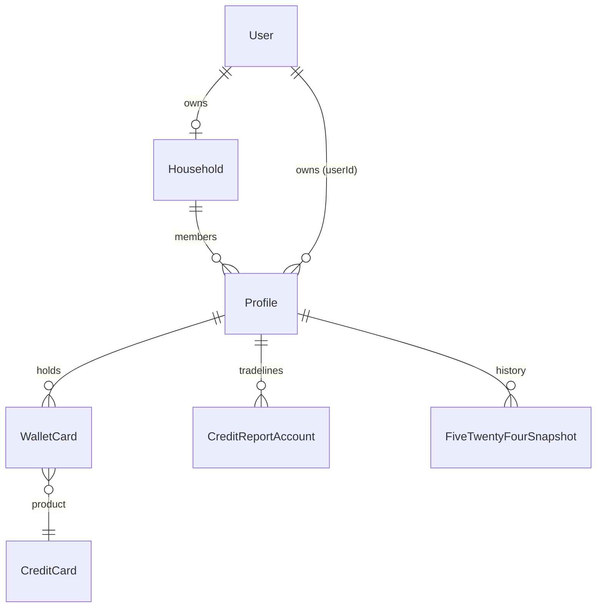

# Household Management

Source: `backend/src/portfolio/households.ts`, `portfolio.ts` · UI: `/household`, member filter on `/portfolio` · Tests: INT `households`, `tests/test-cases/households/`.

## 1. Model

- **Household**: one per account owner (`ownerId` unique), with a name.
- **Cardholder = `Profile`**: `nickname`, `relationship` (SELF, SPOUSE, PARTNER, CHILD, PARENT, OTHER), optional `email`, `birthYear`, `isPrimary`.
- The owner's own member (SELF, `isPrimary`) is created at registration; for older accounts `ensure()` creates/repairs it on first use, serialised with a Postgres advisory lock (pages fire several requests at once).
- A wallet card belongs to a member (`profileId`); cards without one belong to the SELF member. Deleting a member moves their cards to the owner (`ON DELETE SET NULL`).
- `WalletCard.cardholder` = PRIMARY or AUTHORIZED_USER for that member.

## 2. Rules

| Rule | Enforcement |
|---|---|
| Only one SELF member; it can't be deleted or change relationship | `HouseholdsService` (400/403) |
| Children hold **only authorized-user cards** | `HouseholdsService.assertCardholderAllowed` in wallet add/update; changing a member to CHILD is refused while they hold primary cards |
| Members beyond SELF require Pro; max 10 | 403 |
| Object-level access: members, cards and tradelines are owner-scoped | 404/403 (integration IDOR tests) |

## 3. Portfolios

| View | Endpoint | Content |
|---|---|---|
| Separate portfolio | `GET /portfolio?profileId=` | that member's cards and value totals |
| Combined portfolio | `GET /portfolio` | everyone; `byHolder` roll-ups |
| Household dashboard | `GET /household/dashboard` | members → cards, totals, 5/24 status; household totals |
| 5/24 | `GET /five24` | per member (5/24 is personal, never household-wide) |

## 4. Household analytics

Per card / member / household: annual fees, benefit face value, benefits used, missed value, rewards (last 12 months of logged spend), net value (benefits − fees), effective value (benefits used + rewards − fees), return on spend, break-even spend. Definitions in `backend/src/domain/portfolio.ts`.

## 5. API

| Method | Path | Notes |
|---|---|---|
| GET | `/household` | household + members (+ card counts) |
| PATCH | `/household` | rename |
| GET/POST | `/household/members` | list / add (Pro) |
| PATCH/DELETE | `/household/members/:id` | update / remove |
| GET | `/household/dashboard` | analytics |

Legacy `/me/profiles` endpoints keep working (same table).

## 6. Members with their own sign-in (phase 1, 2026-12)

A member can have their own e-mail and password without becoming a separate account.

**Model.** The member's login is a `User` row linked from `Profile.loginUserId` (unique). That row holds only the member's own channels (notification preferences now; mailboxes, alert address, push and briefings in later phases). It has no wallet, plan or household. Cards, loyalty accounts, spending and benefits stay with the owner's user and the member's profile, so household totals, 5/24 and best-card keep working. `Profile.visibility` is `OWN` (default) or `HOUSEHOLD`.

**Invitation.** `POST /household/members/:id/invite` (owner) stores the SHA-256 of a 32-byte token in `MemberInvite` (7 days, single use) and returns the link once (`APP_URL/join/<token>`); it is e-mailed too when the member has an address and mail is configured. A new invite replaces the open one. `GET /auth/invite/:token` (public) shows nickname and household only. `POST /auth/accept-invite` (public, rate-limited) claims the token atomically (`updateMany ... usedAt: null`), creates the user and links the profile in one transaction; a refused password or an address already in use rolls the claim back. The owner (`isPrimary`) cannot be invited. `DELETE .../invite` cancels, `DELETE .../login` removes the sign-in (the user row and its sessions are deleted, data stays); removing a member or deleting the owner's account removes their logins too.

**Enforcement.** The access token of a member carries only a marker; the guard then reads `Profile.loginUserId -> {ownerId, profileId, visibility}` from the database on every request, so removal and visibility changes apply at once. `req.user.sub` stays the member's own id (never the owner's), `req.user.member` holds the scope. A member is **denied everywhere by default**: only controllers or handlers marked `@MemberSafe()` can be reached, and those must use `user.member`, not `user.sub`, for household data. Phase 1 marks only `/member/*`:

| Route | Returns |
|---|---|
| `GET /member/me` | the member's own profile and household name |
| `GET /member/overview` | the member's cards and values (the existing portfolio service pinned to their profile), benefits, loyalty accounts (no account numbers), 25 recent transactions |
| `GET /member/household` | only when `visibility = HOUSEHOLD`: the household dashboard without any sign-in details; read only |

Routes without `@MemberSafe()` return 403, including every write. Public routes (catalog, `GET /offers`) are unchanged. Backups and member exports never carry `loginUserId`, and invites are not restored.

**Not yet:** members cannot add or edit cards themselves (only read routes and their own channels are open).

## 7. Mailboxes and alert addresses per person (phase 2, 2026-12)

Each person can have their own channels, and what a channel carries lands only on that person's cards and points.

**Scope.** `common/channel-scope.ts` resolves a channel to `{ channelUserId, ownerId, profileId }`. A member's own channel (their user id) is always pinned to their profile; an owner's channel is household-wide unless the owner assigned the mailbox to one of their members (`Mailbox.profileId`, validated against the owner's own profiles). Data always lands in the owner's account (`ownerId`); only the review queue ("Which card?") and the address belong to the channel's user.

**What is pinned.** Card matching by last digits (`SpendService.cardForDigits`), statement PDFs, loyalty e-mail and statement matching (`LoyaltyIngestService.accountFor`) and e-mail offer accounts are all restricted to the profile. That is the point of the feature: when two household cards end the same four digits, or two members hold the same program, the household address cannot tell which one (nothing is guessed), while a member's own address can.

| Channel | Who | Feeds |
|---|---|---|
| Alert address (`EmailInbox`) | the owner, and each member with a sign-in | owner: the whole household; member: their own profile |
| Mailbox (IMAP, Gmail, Outlook) | the owner, and each member with a sign-in | as above, and an owner can assign a mailbox to a member who has no sign-in |

**Limits and privacy.** Up to 3 mailboxes per person (the owner's household-wide ones, each member's own, and each member's assigned ones are separate counts). A member's mailbox addresses and alert address are never shown to the owner: the owner sees only counts, last read time, problems and whether an alert address is in use (`channels` on the member). A member cannot connect banks or pick another person's profile. Removing a member's sign-in deletes their mailboxes and address; deleting a member whose mailbox the owner assigned turns that mailbox back into a household-wide one.

**Routes opened to members:** `/mailboxes` (all, including the Gmail and Outlook sign-in and its callback, which sends a member back to `/my/mail`), `GET /capture/status`, `PATCH /capture/inbox`, `POST /capture/inbox/rotate`, `POST|DELETE /capture/items/:id`. Each one acts on the member's own channel user id and resolves their scope from the database.

**Not yet:** a member's own notifications, push, quiet mode and briefings (phase 3). Notifications a member's mail causes (for example a benefit being marked used) still go to the owner.

## 8. Notifications, push, Quiet Mode and briefings per person (phase 3, 2026-12)

**Routing.** `NotificationsService.notify(...)` takes an optional `{ profileId }`. The household owner is notified exactly as before; when the item concerns a member who has their own sign-in, that member also gets their own copy. It follows **their** switches (`memberWants`, `TYPE_SWITCH` in `domain/member-access.ts`: a kind they switched off is not sent; reminders, briefings and system notices have no switch), **their** Quiet Mode, and points at `/my`. A failure in the member copy never stops the owner's.

Items that name a member today: expiring offers (the card's member), card renewals, welcome-bonus deadlines, benefits about to reset (in-app, plus a push if the member turned that on), loyalty points, certificates, memberships and status at risk, stale loyalty data, and offer-sync results (the offer account's member). Household-level items (transfer bonuses, keyword offer alerts, the monthly offer digest) stay with the owner.

**Their own notifications.** `/notifications` (list, unread count, read, read all, preferences) and `/notifications/push` are open to members and act on their own user id: their own list, their own preferences row (created at accept-invite), their own push subscriptions and daily e-mail digest (at their sign-in address). The owner cannot see them and they cannot see the owner's.

**Their own briefing.** `domain/member-brief.ts` builds a daily and a weekly briefing from the member's own profile only (benefits, offers, points, certificates, renewals, bonuses; the week adds spending and balances): what needs them now, what is coming, fee and bonus decisions. No model is involved. A daily one exists only on days something is due; the weekly summary also reports spending and balances. It is stored once per period under the member's own user (`CopilotBriefing`) and announced with one `COPILOT` notification (exempt from Quiet Mode). `POST /member/briefings` makes one now, `GET /member/briefings` lists them. Jobs: `member-daily` (13:05 UTC) and `member-weekly` (Mondays 13:35 UTC), each skipping members who switched that briefing off (`NotificationPreference.briefingDaily` / `briefingWeekly`).

**Not opened to members:** the household Copilot (briefings, settings, memory, goals), the Chief of Staff, and the owner's preferences. A member's preferences screen is `/my/settings`.
