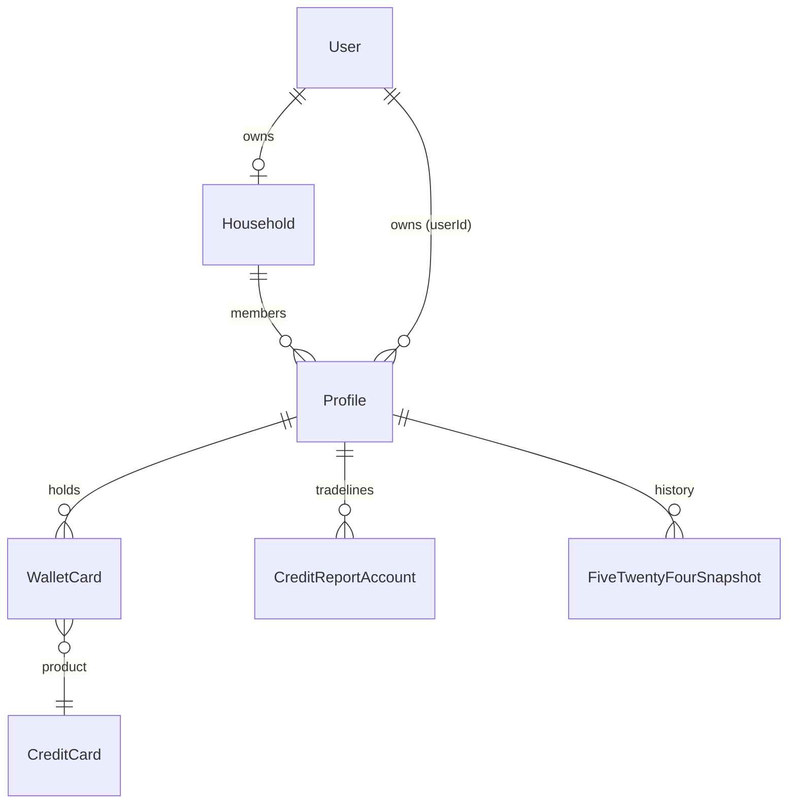

# Household Management

Source: `backend/src/portfolio/households.ts`, `portfolio.ts` · UI: `/household`, member filter on `/portfolio` · Tests: INT `households`, `tests/test-cases/households/`.

## 1. Model

- **Household**: one per account owner (`ownerId` unique), with a name.
- **Cardholder = `Profile`**: `nickname`, `relationship` (SELF, SPOUSE, PARTNER, CHILD, PARENT, OTHER), optional `email`, `birthYear`, `isPrimary`.
- The owner's own member (SELF, `isPrimary`) is created at registration; for older accounts `ensure()` creates/repairs it on first use, serialised with a Postgres advisory lock (pages fire several requests at once).
- A wallet card belongs to a member (`profileId`); cards without one belong to the SELF member. Deleting a member moves their cards to the owner (`ON DELETE SET NULL`).
- `WalletCard.cardholder` = PRIMARY or AUTHORIZED_USER for that member.

## 2. Rules

| Rule | Enforcement |
|---|---|
| Only one SELF member; it can't be deleted or change relationship | `HouseholdsService` (400/403) |
| Children hold **only authorized-user cards** | `HouseholdsService.assertCardholderAllowed` in wallet add/update; changing a member to CHILD is refused while they hold primary cards |
| Members beyond SELF require Pro; max 10 | 403 |
| Object-level access: members, cards and tradelines are owner-scoped | 404/403 (integration IDOR tests) |

## 3. Portfolios

| View | Endpoint | Content |
|---|---|---|
| Separate portfolio | `GET /portfolio?profileId=` | that member's cards and value totals |
| Combined portfolio | `GET /portfolio` | everyone; `byHolder` roll-ups |
| Household dashboard | `GET /household/dashboard` | members → cards, totals, 5/24 status; household totals |
| 5/24 | `GET /five24` | per member (5/24 is personal, never household-wide) |

## 4. Household analytics

Per card / member / household: annual fees, benefit face value, benefits used, missed value, rewards (last 12 months of logged spend), net value (benefits − fees), effective value (benefits used + rewards − fees), return on spend, break-even spend. Definitions in `backend/src/domain/portfolio.ts`.

## 5. API

| Method | Path | Notes |
|---|---|---|
| GET | `/household` | household + members (+ card counts) |
| PATCH | `/household` | rename |
| GET/POST | `/household/members` | list / add (Pro) |
| PATCH/DELETE | `/household/members/:id` | update / remove |
| GET | `/household/dashboard` | analytics |

Legacy `/me/profiles` endpoints keep working (same table).
