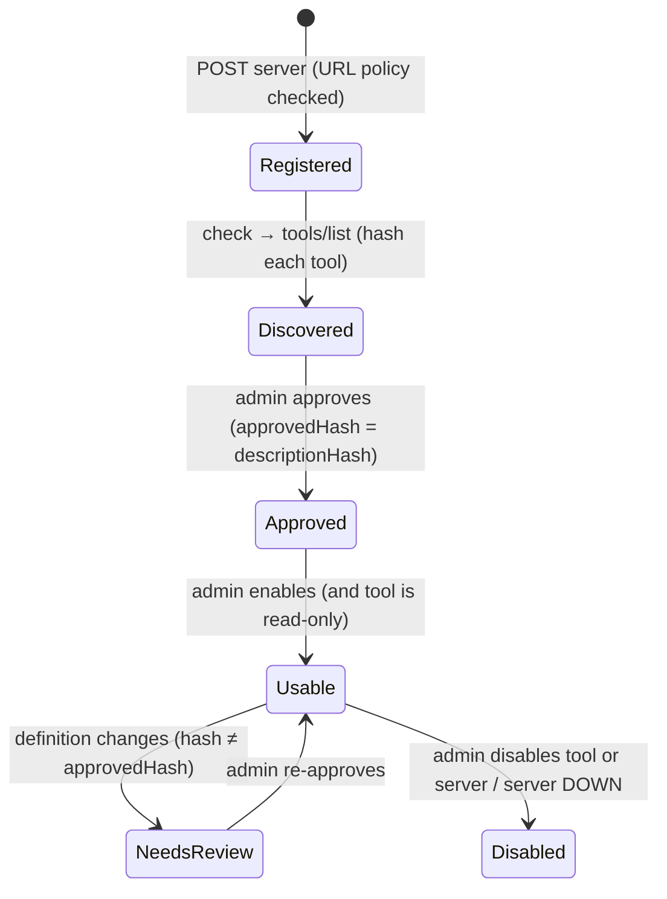

# MCP Registry

Data model: `McpServer` (name, url, authType NONE/BEARER, encrypted secret, status ACTIVE/DISABLED, version, health UNKNOWN/UP/DOWN, lastCheckedAt, lastError) and `McpTool` (server, name, description, inputSchema, descriptionHash, approvedHash, enabled, readOnly). Admin API: `GET/POST /admin/mcp/servers`, `PATCH/DELETE /admin/mcp/servers/:id`, `POST /admin/mcp/servers/:id/check`, `PATCH /admin/mcp/tools/:id {approve, enabled, readOnly}`; attach via `PATCH /admin/ai/agents/:key {mcpToolIds}`. All changes are audit-logged (secrets excluded).

## Lifecycle

## Catalogue of the requested servers

| Server | Typical transport | Place in Pointwise | Notes |
|---|---|---|---|
| **Pointwise** (this app) | Streamable HTTP | ✅ Built in at `/mcp` for users' own AI apps | PAT auth, public catalog tools only (no user card data) |
| Documentation MCP (e.g. a docs search server) | remote HTTP | ✅ Admin registry → attach read-only search tools to assistants | good fit |
| Web Search MCP | remote HTTP | ⚠️ Admin registry, read-only, review carefully | results are untrusted content (labelled); consider allow-listed domains server-side |
| GitHub MCP | remote HTTP | ⚠️ Admin/operator use only | not relevant to card data; never with write scopes on user assistants |
| Filesystem MCP | stdio (local) | ❌ Not attachable (stdio not supported by design) | operator tooling outside the app |
| PostgreSQL MCP | stdio / local | ❌ Not attachable | would bypass tenant isolation |
| Git MCP | stdio | ❌ Not attachable | operator tooling |
| Browser / Playwright MCP | stdio | ❌ Not attachable | would let the model drive a browser from the server |
| Custom user MCP servers | remote HTTP | ❌ End users cannot register; admins can, under the same policy | prevents SSRF and tool poisoning |

## Operating guidance
- Prefer read-only, narrowly scoped servers. Give each its own credential with the least privilege.
- Set `MCP_ALLOWED_HOSTS` in production to the exact hosts you use.
- Review tool descriptions before approving; re-review when a tool shows "changed — review".
- Watch `health`/`lastError` on the admin page and in logs (`check-mcp-servers` job every 15 min).
