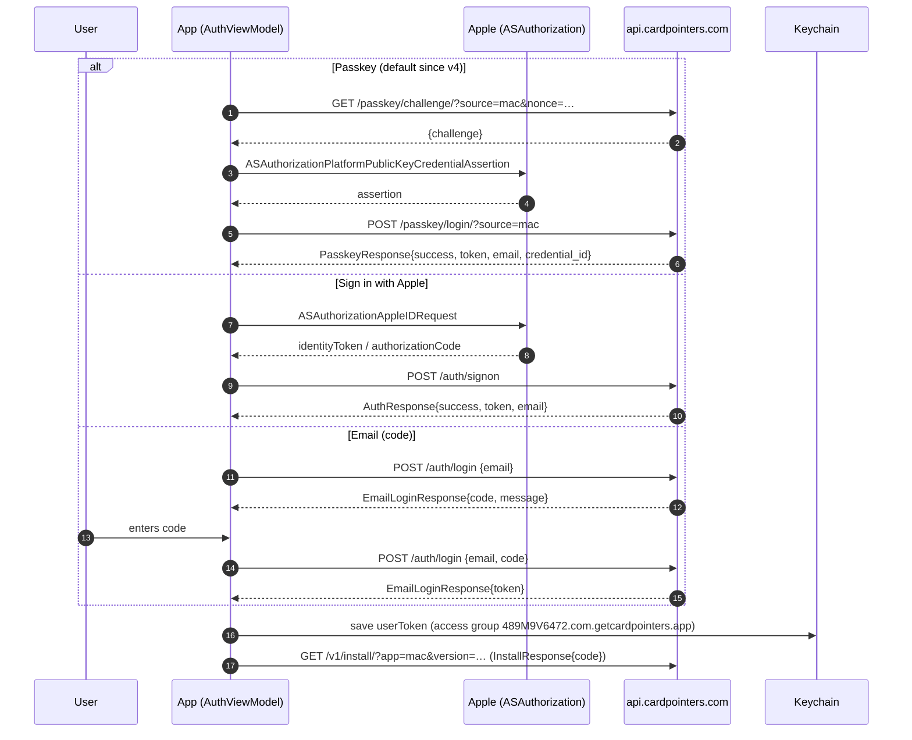
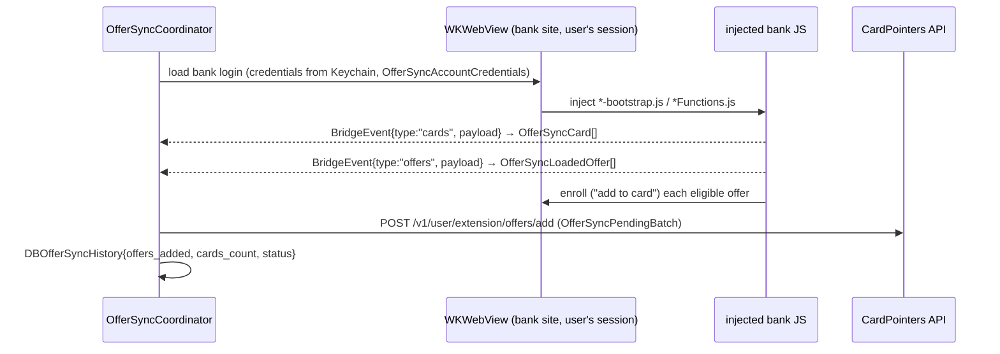

# Phase 6 — Network Analysis

> **Evidence type:** static only. Endpoints come from `__cstring` literals (`raw/urls.txt`); request/response schemas come from Swift `Codable` field metadata (`raw/swift-fields-app.tsv`). Swift stores strings of 15 bytes or fewer *inline in instructions*, so a few short path components (e.g. `me/`) are inferred from neighbouring fragments and marked ⚠︎. No live traffic was captured.

## 1. Hosts

| Host | Purpose |
|---|---|
| `api.cardpointers.com/api` | Primary REST API (v1) |
| `x.cardpointers.com/api/v1` | Alternate API host used by the Safari extension (token refresh) |
| `pass.cardpointers.com/pass/apple?u=` | Apple Wallet pass generation |
| `u.cardpointers.com` | Share / short links |
| `cardpointers.com/open/{search,pointers,offers,cards,ai}/` | Universal links → in-app routes |
| `cardpointers.com/{cards,offers}/` | Public web pages |
| `help.cardpointers.com` | Help center |
| `api.revenuecat.com`, `api.rc-backup.com`, `api-paywalls.revenuecat.com`, `api-diagnostics.revenuecat.com` | Subscriptions (RevenueCat SDK) |
| `us.i.posthog.com`, `eu.i.posthog.com` (+ assets) | Analytics (PostHog SDK) |
| Bank sites: `global.americanexpress.com`, `secure01a.chase.com`, `online.citi.com`, `secure.bankofamerica.com`, `connect.secure.wellsfargo.com`, `onlinebanking.usbank.com` | Offer Sync (loaded in WKWebView, user's own session) |
| `maps.apple.com` | Directions |

**No GraphQL or WebSocket endpoints were found.** Push delivery uses APNs (`aps-environment=production`).

## 2. Authentication

- **Token:** opaque Bearer token (`Authorization: Bearer <token>`), stored in Keychain (`KeychainItem`).
- **Refresh:** `POST /api/v1/user/token/refresh`. A `WalletTokenRefreshGate` serializes refreshes. Log: *"/me returned 401; serializing token refresh before retry"*. If no token is available after refresh, local data is preserved, not wiped.
- **Passkey management:** `GET /api/v1/user/passkeys/`, `POST /v1/user/passkeys/add/?source=mac`, `POST /api/v1/user/passkeys/delete/{id}`, `POST /passkey/signup/?source=mac`.
- **Account deletion:** `POST /api/v1/user/delete`.

## 3. Endpoint inventory

Base: `https://api.cardpointers.com/api`. Methods are *inferred* (mutations → POST) unless a query string was observed.

### Sync / read

| Method | Path | Response model |
|---|---|---|
| GET | `/v1/user/me/` ⚠︎ | `MeResponse{data: MeDataResponse, message}` — watermarks `updated`, `newest_card`, `newest_offer`, `newest_message`, `newest_merchant`, `newest_offer_inventory_id` |
| GET | `/v1/user/wallet/?app=mac&version=` | `Wallet` |
| GET | `/v1/user/notifications/?since=` | `MessagesDataResponse` → `[NotificationMessage]` |
| GET | `/v1/user/offers/newest/?since_id=` | `NewestOffersResponse{success, offers[Checklist], added_count}` |
| GET | `/v1/user/offers/streak/?since=` | `OfferStreakResponse{streaks[OfferStreak], profile_uuid}` |
| GET | `/v1/user/offers/other/{cardId}` | `OfferDetailsResponse` |
| GET | `/v1/cards/` | `AllOtherCardsResponse{cards[SimpleCard]}` (catalog) |
| GET | `/offers/{slug}` | public offer details |
| GET | `/v1/user/notifications/unread` | unread count |
| GET | `/v1/user/offer_alerts/active` | `[OfferAlert]` |
| GET | `/v1/user/manage/link/` | `ManageLinkResponse{url, store}` (subscription management) |
| GET | `/v1/install/?app=mac&version=` | `InstallResponse{code}` |

### Cards (inventory)

| Method | Path | Notes |
|---|---|---|
| POST | `/v1/user/cards/add` | add card from catalog → `SuccessResponse{inventory_id}` |
| POST | `/v1/user/cards/add_multiple` | onboarding bulk add |
| POST | `/v1/user/cards/new` | user-defined card (`NewCardView`) |
| POST | `/v1/user/cards/delete` | |
| POST | `/v1/user/cards/order` | reorder |
| POST | `/v1/user/inventory/update` | edit nickname, notes, status, fee, dates, bonus plan, bonus categories |
| POST | `/v1/user/inventory/change` | product change (`ProductChangeView`) |
| POST | `/v1/user/inventory/external/reassign` | Offer Sync card remapping |

### Offers (checklist)

| Method | Path | Notes |
|---|---|---|
| POST | `/v1/user/checklist/update` | toggle redeemed, amounts used, snooze (`hide_until`), dates |
| POST | `/v1/user/checklist/update/favorite` | |
| POST | `/v1/user/checklist/update/automation` | auto_favorite / auto_redeem / auto_delete for recurring offers |
| POST | `/v1/user/offers/add_existing` | add catalog offer to a card |
| POST | `/v1/user/offers/add_custom` | custom offer (`AddCustomOfferView`) |
| POST | `/v1/user/offers/update_custom` | |
| POST | `/v1/user/offers/backfill` | `BackfillPastOffersResult` |
| POST | `/v1/user/extension/offers/add` | offers found by Offer Sync / Safari extension (`OfferSyncPendingBatch{cards, offers}`) |
| POST | `/v1/user/offer_alerts/addedit` | `OfferAlert` |
| POST | `/v1/user/offer_alerts/delete` | |

### Pointers / merchants

| Method | Path |
|---|---|
| POST | `/v1/user/pointers/favorites` |
| POST | `/v1/user/pointers/pinned_cards` |
| POST | `/v1/user/merchants/new` |

### Profiles (household)

`POST /v1/user/profiles/{add,edit,delete,order,link}` → `NewProfilesResponse{profiles[Profile]}`.

### Monetization / misc

| Method | Path | Notes |
|---|---|---|
| POST | `/v1/user/purchase/link` | link web purchase (`LinkPurchaseResponse`) |
| POST | `/v1/user/paywall/answers` | paywall survey answers |
| POST | `/v1/user/notifications/read` | mark read |

## 4. Request conventions (observed / inferred)

- JSON bodies (`application/json; charset=utf-8`), snake_case keys (matching `CodingKeys`).
- Query `app=mac&version=<CFBundleShortVersionString>` and `source=mac` identify the client.
- Delta sync: the client stores the `newest_*` watermarks from `/me`, and refetches `/wallet` only if `updated` changed. `lastAppliedWalletPayloadDigest` skips re-applying identical payloads.
- Mutations return `SuccessResponse{success, message?, inventory_id?, refresh?, bank_id?, offer_alert_id?}`. `refresh=true` tells the client to re-pull the wallet.

## 5. Offer Sync (bank automation) network model

Bank credentials stay on-device (Keychain). The CardPointers backend only receives the resulting offers.

## 6. OpenAPI

Machine-readable spec of the **observed** API: [`../api/cardpointers-observed.openapi.json`](../api/cardpointers-observed.openapi.json).
The **new web app's** API is specified separately in `api-spec.md` / `../api/openapi.yaml`.
