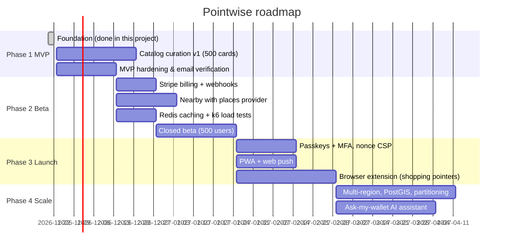

# Phase 16 — Implementation Roadmap

Effort is in engineer-weeks (ew), for a team of 2 full-stack engineers, 1 designer (part-time) and 1 data/catalog curator.

## Phase 1 — MVP (≈ 8 ew; ~60 % already delivered as working code)

| Item | Status | Effort |
|---|---|---|
| Auth (email/password, Google, Apple), sessions, reset | ✅ built | — |
| Catalog, wallet, best-card engine, offers, calculator, dashboard, 5/24, renewals, bonuses | ✅ built | — |
| Admin portal (catalog CRUD, audit, jobs) | ✅ built (basic UI) | 1 ew to finish card/merchant editors in the UI |
| Notifications + worker + email digest | ✅ built | — |
| Email verification, account lockout (M-2, M-4) | ⏳ | 1 ew |
| Real card catalog: curate ~500 popular US cards and their earning rules | ⏳ | 4 ew (curator) |
| CI pipeline (lint, unit, integration, E2E, audit) | ⏳ | 1 ew |
| Production infra (managed Postgres/Redis, container hosting, TLS, backups) | ⏳ | 1.5 ew |

**Exit:** all P0 cases green; 50 internal users.

## Phase 2 — Beta (≈ 10 ew)
Stripe Checkout + Billing Portal + webhooks (replace the `mock` provider); places provider for Nearby (Foursquare/Google/OSM) with merchant matching; Redis caching + throttler storage; k6 load tests; household profiles UI; offer alerts UI; CSV import of offers; observability (OTel, Sentry); closed beta with feedback loop.
**Exit:** SLOs met under 5× expected beta load; payment flows certified in Stripe test mode.

## Phase 3 — Launch (≈ 12 ew)
Passkeys (WebAuthn) and optional TOTP; nonce-based CSP; PWA install + web push notifications; browser extension that detects the merchant by host (`/merchants/by-host`) and shows the best card; SEO public card pages; GDPR/CCPA tooling (consent, DSR automation); accessibility audit by a third party.
**Exit:** public launch; 99.9 % availability.

## Phase 4 — Scale (≈ 14 ew)
Read replicas + PgBouncer; PostGIS for locations; partitioned analytics; set-based notification jobs; multi-region deployment; LLM "ask my wallet" assistant using tool calls over the recommendations API; partner/affiliate integrations (compliant apply links); international catalogs (CA, UK, AU).

## Portfolio revision (2026-11-22)

Delivered as working code: households, benefit tracker + alerts, full 5/24 engine, portfolio analytics, spreadsheet/CSV import, Plaid sandbox connector, credit-report tradelines, scheduler + notification-service (≈ 6–8 ew of product scope as a vertical slice). Remaining:

| Item | Effort | Depends on |
|---|---|---|
| Plaid production: contract, Link widget (CSP for cdn.plaid.com), webhooks, re-auth UX | 2 ew | Plaid approval |
| Curated benefit catalog for real card products (+ admin CRUD for templates) | 2 ew | data licensing / editorial |
| Experian (or other bureau) partnership integration | 4–6 ew | business agreement, FCRA review |
| Push UX polish (per-device management, quiet hours) and VAPID key rotation | 1 ew | — |
| Benefit usage auto-detection from transactions (match merchant → credit) | 2 ew | transaction feed |

## AI platform (2026-11-23)

Delivered (Phase A + B of the AI plan, ≈ 6–8 ew): provider layer + router, assistant and agents, tools, consent/budgets/usage, admin AI page, Pointwise MCP server, admin MCP registry. Privacy boundary (2026-11-24): no AI provider or MCP client receives user card data. **Phase C delivered (2026-11-24):** card knowledge base, admin-reviewed extraction refresh engine, offer history, welcome-bonus/annual-fee/retention APIs, `/admin/catalog`. Next:

| Phase | Scope | Effort |
|---|---|---|
| C ✅ | Card master database fields, `CardDataSource`/`CardChangeProposal`/`CardOffer`, refresh engine with admin review, offer history APIs ([card-refresh-engine.md](card-refresh-engine.md), [card-offer-history.md](card-offer-history.md)) | 4–6 ew + curation |
| D ✅ (2026-11-25) | Deterministic recommendation scorer (first-year / long-term value, ROI, 5/24 impact, confidence) + travel: programs, transfer partners, balances, redemption suggestions | 3–4 ew |
| E ✅ (2026-11-25) | Streaming answers (SSE), eval set for answer grounding, live-provider smoke tests (opt-in), admin logs/health page | 2 ew |

All five phases of the AI plan are delivered. **Phase F (2026-11-26):** credit-band approval odds in the scorer, transfer-bonus alerts, fine-print search (public, full-text, no AI), streaming verified through the web proxy. Candidates next: licensed card-data feed adapter, award-availability provider adapter (commercial), email/push delivery for transfer-bonus alerts.

**Catalog coverage (2026-12-04):** 112 curated real cards (personal + business) and an issuer registry of 39 banks, credit unions and fintechs; *Research all issuers* and a coverage report; personal / business filter in the card search.

**Credit report import (2026-12-02, three bureaus 2026-12-03):** Experian, Equifax and TransUnion reports (annualcreditreport.com, bureau sites) and Credit Karma; merged per account across bureaus; as printed PDF or copied text → open dates on wallet cards and recent cards added for 5/24 — see credit-report-import.md.

**Automatic capture (2026-12-01):** Plaid Link + verified webhooks + re-link, and a private forwarding address for card alert emails (statement PDFs attached are imported too); alerts and posted transactions are merged — see auto-capture.md.

**Phase H (2026-11-29):** spend tracking (statement CSV, Plaid transactions, manual) with automatic benefit tracking — purchases record expected credit use, issuer statement credits confirm it, rules suggested per benefit and editable — see spend-tracking.md.

**Phase G (2026-11-27):** card-research agent (Claude web search/fetch limited to issuer domains, evidence checked by Pointwise, admin approval) and a curated real-card catalog (112 cards — 83 personal, 29 business — from 15 issuers incl. credit unions; unverified until confirmed) selectable with `SEED_CATALOG` — see card-research-agent.md. Lead sites (Doctor of Credit, The Points Guy, MileMoa) and a NEWS scan task added 2026-11-28 (validated: unit 448, int 125, PW 62, CY 37) (discovery only; issuer pages remain the source of facts).

## Effort summary

| Phase | Effort | Calendar (2 eng) |
|---|---|---|
| 1 MVP | 8 ew (≈ 5 remaining) | 3–4 weeks |
| 2 Beta | 10 ew | 5–6 weeks |
| 3 Launch | 12 ew | 6–7 weeks |
| 4 Scale | 14 ew | 7–8 weeks |
| **Total** | **≈ 44 ew** | **≈ 6 months** |

## Risks

| Risk | Likelihood | Impact | Mitigation |
|---|---|---|---|
| Catalog accuracy (earning rules change often) | High | High | Curator workflow in the admin portal, audit log, "report error" feature, scheduled reviews |
| Users expect automatic offer sync like native apps | High | Medium | Clear positioning; CSV import; browser extension; partner APIs (issuer-approved) where available |
| Legal/ToS when referencing bank programs | Medium | High | Original data entry, no scraping, legal review of affiliate links and trademarks |
| Location data accuracy on the web | Medium | Medium | Places provider; user correction; never store location |
| Payments & tax compliance | Medium | Medium | Stripe Tax, Billing Portal |
| Security incidents (finance-adjacent PII) | Low | High | Security findings M-1…M-4 closed before launch; pen test |
| Docker/dev environment constraints (seen in this project: host disk full) | Medium | Low | Document disk requirements; CI as source of truth |

## Dependencies

Card catalog source and curation process · Stripe account · OAuth apps (Google Cloud, Apple Developer with Services ID + key) · SMTP provider (Postmark/SES) · places API key · hosting (e.g. Fly.io/Render/AWS ECS) · domain + TLS.

## Recommended implementation order
1. Close security items M-1, M-2 and CI (cheap, unblock launch hygiene).
2. Catalog curation tooling plus the first 500 cards (product value depends on data).
3. Stripe billing (revenue).
4. Nearby with a real places provider (key differentiator).
5. Caching and load tests (before beta traffic).
6. Passkeys, PWA push, browser extension (engagement).
7. Scale work as metrics demand.
