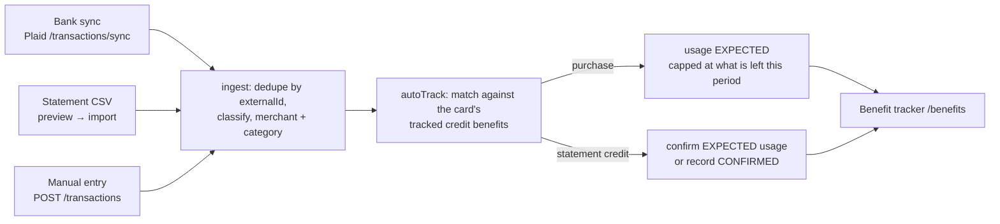

# Spend Tracking & Automatic Benefit Tracking

Status: **built (2026-11-29, Phase H)**. Source: `backend/src/domain/spend.ts` (pure: statement parsing, classification, categories, rule suggestion, matching), `backend/src/spend/` (service + API), bank sync in `backend/src/portfolio/connections.ts`; UI `/spending` and the auto-tracking section on `/benefits`. Tests: `backend/test/unit/spend/spend.spec.ts`, `backend/test/unit/imports/connections.spec.ts`, `backend/test/integration/spend.int-spec.ts`, `frontend/test/spend.test.ts`, `playwright/tests/spending.spec.ts`, `cypress/cypress/e2e/spending.cy.ts`, `tests/spend/`.

> **Automatic capture:** bank webhooks and forwarded card alert emails make statement uploads unnecessary — see [auto-capture.md](auto-capture.md).

## 1. Goal
Trace every card's spending and keep the benefit tracker current without manual logging: a $23 Uber ride on a card with a $10 monthly rideshare credit records $10 of expected use the moment the purchase arrives, and the issuer's "UBER CASH CREDIT" confirms it when it posts.

## 2. Flow

## 3. Getting transactions
| Channel | How |
|---|---|
| Bank sync | Plaid `/transactions/sync` (products `liabilities` + `transactions`), cursor stored per connection (`BankConnection.txCursor`). Posted transactions only (pending ones wait); removed ones are deleted (their auto-usage goes with them). Accounts map to wallet cards through the account id stored at account sync. Runs on connect, "Sync", and the daily `sync-bank-connections` job. A transactions failure never breaks the account sync. |
| Statement CSV | `/spending` → choose card → upload the issuer's CSV export → **preview** (nothing saved: kinds, categories, merchants, duplicates, which benefit each row updates) → **import**. Finds the header row (preamble lines allowed); date / description / amount (or debit + credit) / category columns by name; purchases positive or negative detected from payment lines (or the majority), overridable. Dedupe key: hash of card + date + amount + descriptor + occurrence number, so re-importing a statement adds nothing while two identical coffees stay two. 2 MB / 5,000 rows. |
| Statement PDF | Same upload (preview → import). Most issuers offer only PDF statements, so this is the main path. See §3a. |
| Manual | `POST /transactions` (purchase or `kind: CREDIT`), unchanged otherwise; also auto-tracked. |

### 3a. PDF statements (2026-11-30)
- **Extraction (sandboxed):** `spend/pdf-text.mjs` (pdfjs-dist 6.4, eval disabled, no fonts, document from memory) runs in a **separate Node process** with a 256 MB heap, a 20 s timeout, an 8 MB output cap, an empty environment and a 40-page limit. The API never parses an untrusted PDF in-process. Text items are regrouped into lines by baseline, left to right.
- **Parsing (deterministic, no AI — statements are card data):** `domain/spend-pdf.ts`. Transaction lines start with a date (`11/02`, `11/02/26*`, `Nov 2`, optionally a post date) and end with an amount. Credits: `-$10.00`, `($10.00)`, `10.00 CR`, `10.00-`, or any line under a *Payments and credits* heading. Summary lines (new/previous balance, totals, minimum payment, interest tables) are skipped. Years come from the statement period / closing date (December rows on a January statement get the previous year), else the upload date. Reference-number and account-number columns are dropped; digit runs of 8+ are never stored.
- **What is kept:** only the parsed transactions (source `PDF`, dedupe key `pdf:` + hash). The file and its full text are discarded after the request.
- **Errors:** password-protected → "download it again without a password"; no text layer (scanned / photo) → use the PDF from the card's website or CSV; text but no transaction lines → no rows found; > 10 MB, > 40 pages, unreadable or slow files are rejected.
- **Covered layouts:** Chase-, Amex-, Citi-/Discover-, Capital One- and Bank of America-style lines (unit tests use synthetic statements). Layouts that put the date, description and amount on separate lines are not read; use CSV or bank sync for those.

Each transaction stores `kind` (PURCHASE, CREDIT = issuer statement credit, REFUND, PAYMENT, FEE — amounts always positive), `source` (MANUAL/CSV/BANK), `externalId`, the bank's category label, and the matched merchant (name or web host in the descriptor) and category (merchant's category, else the bank category mapped: Plaid `personal_finance_category` and common statement labels). Spend analytics (rewards by card, spend profile for the next-card scorer, `/spending/summary`) count purchases only. Imported purchases inside the welcome-bonus window add to bonus progress.

## 4. Matching rules
Each tracked benefit has rules `{keywords, categories, creditKeywords}`:
- **Suggested** (default, `autoRules = null`): from the benefit category (rideshare → uber, lyft; CLEAR → clear; trusted traveler → global entry, tsa, cbp, nexus, precheck; dining → dining purchases; airline → airline purchases; hotel → hotel purchases; streaming & entertainment → streaming purchases) plus brand names found in its name / "how issued" text (Uber, DoorDash, Walmart, Saks, Equinox, …). Credit keywords = those brands + the meaningful words of the name ("Dining credit" → dining).
- **Custom:** editable per benefit on `/benefits` (or `PUT /benefits/:id/auto-tracking`); "Use suggested rules" resets; tracking can be switched off per benefit. Catalog templates can carry rules (`Benefit.autoRules`), copied when a card is added.

Matching (word boundaries; "clear" ≠ "nuclear"):
- **Purchase** → the first benefit whose merchant word appears in the descriptor/merchant; otherwise a benefit without merchant words whose category matches. Records **EXPECTED** usage of `min(purchase, amount left in that period)`; nothing when the period is used up.
- **Statement credit** → the benefit with the longest matching credit word. It confirms that benefit's EXPECTED usages from the previous 60 days (oldest first, up to the credit amount, amount set to what was credited); any remainder is recorded as CONFIRMED usage (capped).
- Payments, refunds and fees never match. Only benefits of kind CREDIT with a value, enabled and auto-tracked, on the **same card** are considered.

## 5. Control and correctness
| Rule | How |
|---|---|
| Idempotent | a transaction is used once per benefit (unique `userBenefitId + transactionId`; credits checked by `creditTransactionId`); re-running matching (`POST /spending/rescan`, after rule changes) only adds what is missing |
| "Not this benefit" | an automatic usage can be dismissed → kept as DISMISSED with amount 0, so it is never re-created; manual entries are deleted instead |
| Deleting a transaction | its usage is removed (FK cascade); usage a deleted credit had confirmed goes back to EXPECTED |
| Manual first | expected/confirmed and manual usage share the period cap, so auto-tracking never pushes a benefit past its value |
| Display | `/benefits` shows the rules (or "suggested"), the latest automatic matches with "auto · credit expected / posted" and the transaction; `/spending` shows each transaction's benefit updates |
| Privacy | deterministic code only — transactions are never sent to an AI provider or MCP client; the assistant's benefit tools stay private (answered by PointWise) |

## 6. API
| Route | Purpose |
|---|---|
| `GET /spending/transactions?walletCardId&kind&matched&limit` | transactions with category, merchant, card and the benefit updates each made |
| `GET /spending/summary?days` | purchases by category and card; automatic tracking totals (expected / posted) |
| `POST /spending/statements/preview` (multipart `file` .pdf ≤ 10 MB or .csv ≤ 2 MB, `walletCardId`, `purchasesAre?` for CSV) | parse + match, nothing saved; includes `format` and statement `period` |
| `POST /spending/statements` (same) | import; returns imported, duplicates, benefit updates |
| `POST /spending/rescan` `{walletCardId?, days?}` | re-run matching |
| `PUT /benefits/:id/auto-tracking` `{autoTrack?, rules? | null}` | rules / on-off; rescans the card |
| `POST /benefits/usages/:usageId/dismiss` | "not this benefit" |
| `POST /transactions` | + optional `kind: CREDIT`; response includes `benefitUpdates` |

## 7. Data (migrations `20261129000000_spend_auto_benefits`, `20261130000000_pdf_statements` adds source PDF)
Enums `TransactionKind`, `TransactionSource`, `UsageSource` (MANUAL / AUTO_PURCHASE / AUTO_CREDIT), `UsageStatus` (CONFIRMED / EXPECTED / DISMISSED). `Transaction` + kind, source, externalId (unique per card), bankCategory, createdAt, FKs to Category / Merchant (dangling ids cleared). `Benefit.autoRules`; `UserBenefit.autoTrack`, `autoRules`; `BenefitUsage` + source, status, transactionId (cascade), creditTransactionId (set null); `BankConnection.txCursor`.

## 8. Limits
- Statement credits whose descriptor names neither the brand nor the benefit (e.g. a generic "STATEMENT CREDIT") are not matched — add a credit word in the rules, or log it manually.
- Benefits that depend on enrollment or a specific booking channel (e.g. "hotels booked through the issuer's portal") match by category and may need a manual correction ("Not this benefit").
- Live bank transactions need a production Plaid account with the `transactions` product; the sandbox works out of the box.
- PDF statements: text PDFs only (no OCR for scans); unusual layouts may need CSV or bank sync. A PDF and a CSV of the same month are not de-duplicated against each other (descriptions differ), so import one or the other.

## Validation, detection and audit

Every imported statement is checked against an independent scan of its own lines (`statement-validate.ts`): transaction count, imported count, difference, statement vs imported amount, missing amount, confidence and a PASS / WARNING / FAILED status. Transactions printed over several lines are joined before parsing. Benefit matching now uses the detection engine (`benefit-detect.ts`) with a confidence per match; review-tier matches and manual overrides are on the Benefit audit page. Optional AI classification only ever sees a cleaned merchant string and is off unless the user turns it on.
