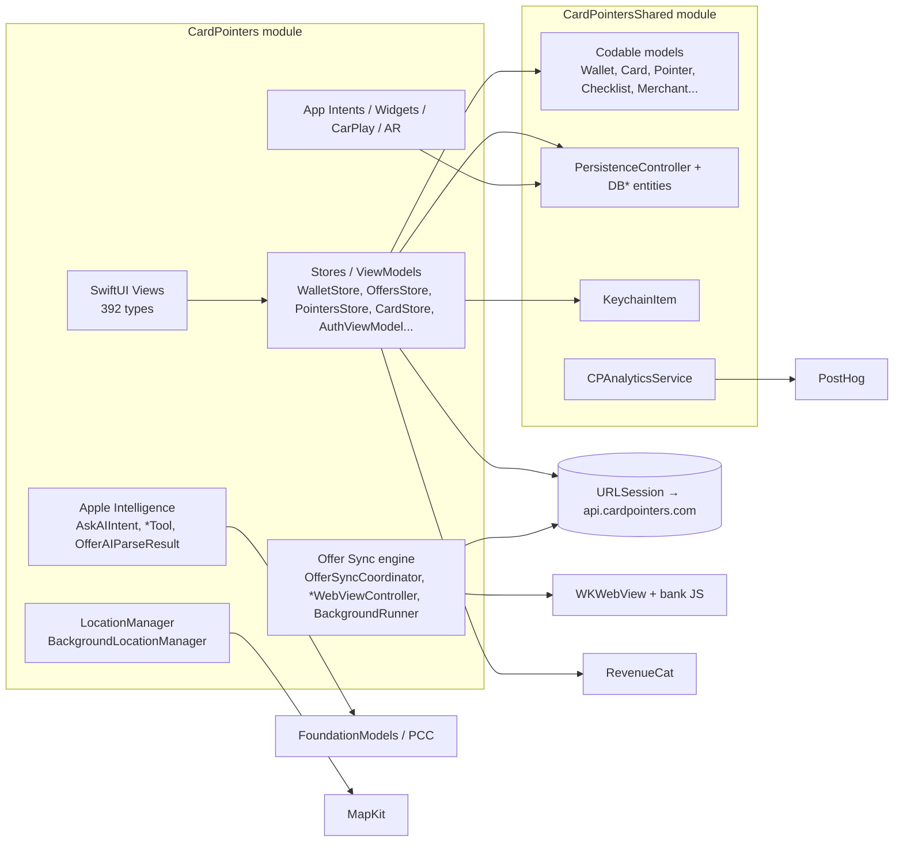
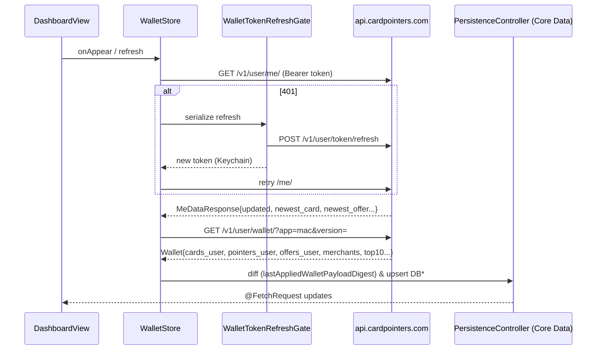
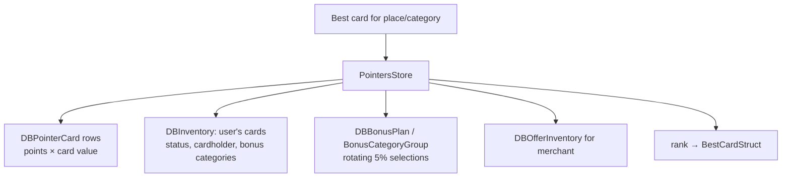

# Phase 3 — Static Binary Analysis

Evidence lives in `project-analysis/raw/` (`*.strings.txt`, `*.dylibs.txt`, `*.entitlements.plist`, `*.codesign.txt`, `swift-types.tsv`, `swift-fields.tsv`, `objc-imported-classes.txt`, `urls.txt`).
REA release-exposure evidence ID: `ev_2561787e2f342e21404da5d3e310983a10b4bfb32b0b82b032011ba39cbd9aa5`.

> **Method note:** every statement here is a *static* observation from the shipped artifact unless marked *inferred*. Nothing was executed.

## 1. Binary summary

| Binary | Arch | Size | Imported symbols (arm64) | Defined symbols | Linked dylibs |
|---|---|---|---|---|---|
| CardPointers | x86_64 + arm64 | 56.6 MB | 6,085 | 234 (stripped) | 105 |
| CPWidgetExtension | x86_64 + arm64 | 9.3 MB | 598 | 18,653 | 56 |
| CPPointersWidgetExtension | x86_64 + arm64 | 6.1 MB | 531 | 13,280 | 49 |
| CPSafariExtension | x86_64 + arm64 | 6.1 MB | 523 | 13,178 | 45 |
| CardPointersMenuBar | x86_64 + arm64 | 0.6 MB | 562 | 1 | 23 |
| CardPointersSyncHelper | x86_64 + arm64 | 0.2 MB | 211 | 1 | 21 |

The extensions keep many defined symbols because they statically link the `CardPointersShared` module (models + Core Data) and the SDKs; the main app is fully stripped.

### Mach-O sections of interest (main, arm64)
`__swift5_types`, `__swift5_fieldmd`, `__swift5_reflstr`, `__swift5_typeref`, `__swift5_protos`, `__swift5_proto`, `__swift5_assocty`, `__swift5_mpenum`, `__swift_as_entry/cont/ret` (async), `__objc_classlist`, `__objc_methname`, `__oslogstring`, `__cfstring`, `__cstring`.
The `__swift_as_*` sections show heavy Swift Concurrency (async/await) use.

## 2. Classes / protocols / methods / selectors

| Inventory | Count | Source |
|---|---|---|
| Swift nominal types (all modules) | 3,262 (588 classes, 1,659 structs, 861 enums, 154 protocols) | `__swift5_types`, `__swift5_protos` |
| …of which `CardPointers` module | 1,217 | |
| …of which `CardPointersShared` module | 131 | |
| RevenueCat / RevenueCatUI / PostHog | 923 / 441 / 229 | |
| Swift classes exposed to ObjC runtime (`_TtC12CardPointers…`) | 92 | `__objc_classname` |
| Imported ObjC classes | 275 | `nm -u` `_OBJC_CLASS_$_*` |
| ObjC selector-like strings | 1,671 | `__objc_methname` |
| Swift field descriptors | 3,254 (1,268 app-owned) | `__swift5_fieldmd` |

App-owned Swift types by role (heuristic, by type-name suffix):

| Role | Count |
|---|---|
| SwiftUI views / rows / modifiers | 392 |
| State stores / services / coordinators | 88 |
| App Intents (+responses) | 74 |
| Codable `CodingKeys` | 71 |
| DTOs (`*Response`, `*Struct`, `*Result`) | 47 |
| AppEntity / EntityQuery | 45 |
| FoundationModels tools / `@Generable` types | 30 |
| Core Data `NSManagedObject` subclasses | 22 |
| Other (enums, helpers, nested) | 579 |

## 3. Imports (linked frameworks)

Grouped from `otool -L` (full list: `raw/CardPointers.dylibs.txt`):

- **UI:** SwiftUI, UIKit (iOSSupport), AppKit, Charts, MapKit (+SwiftUI), AVKit, PhotosUI, SafariServices, WebKit, LinkPresentation, MessageUI
- **Data:** CoreData, CoreSpotlight, Contacts, Photos, CoreTransferable
- **System integration:** AppIntents, Intents, WidgetKit, CarPlay, WatchConnectivity, UserNotifications, ServiceManagement (login items), SharedWithYou, PassKit, StoreKit, AdServices
- **Location/AR:** CoreLocation (+UI), GeoToolbox, ARKit, RealityKit/RealityFoundation, SceneKit, SpriteKit, CoreMotion
- **Intelligence:** FoundationModels (on-device LLM), NaturalLanguage, Vision, VisualIntelligence
- **Security:** Security (Keychain), CryptoKit, AuthenticationServices (Sign in with Apple, passkeys)
- **Low-level:** libz, libc++, Swift runtime overlays (Concurrency, RegexBuilder, Observation, …)

## 4. Exports

Main executable exports only standard entry points (`_main`, `__mh_execute_header`, plus Swift async hooks); there is no public API surface. Extension binaries export `CardPointersShared` symbols internally (not a stable ABI).

## 5. Dependency diagram

## 6. Call-graph (architectural, inferred from type names + strings)

Function-level call graphs require decompiling the stripped binary (Ghidra import of the 28 MB arm64 slice). The flows below are reconstructed from type names, log strings (e.g. `"/me returned 401; serializing token refresh before retry"`) and Codable models.

## 7. Strings of note

- `api.cardpointers.com/api/v1/...` – 40+ REST routes (see networking.md)
- `x.cardpointers.com/api/v1/user/token/refresh` – used by the Safari extension
- `pass.cardpointers.com/pass/apple?u=` – Wallet pass generation
- `u.cardpointers.com` – short links / sharing
- `/passkey/challenge|login|signup/?source=mac` – WebAuthn
- Log messages expose control flow (e.g. `"*** Unable to save userToken to keychain."`, `"/me retry skipped because no token was available after refresh; preserving local account data"`).
- A build-machine DerivedData path (developer home directory) is embedded via a vendored C file path — minor information disclosure (see security-review.md).

## 8. Release-exposure audit (REA)

| Check | Status |
|---|---|
| Debug companions (.dSYM, maps) | not observed |
| Extractable payload | not observed |
| Credential markers in text | unknown (no hits; 4 members skipped for size) |
| Source maps | unknown (5 skipped) |
| Electron/Go/Rust checks | not applicable |

No exposures were observed in the assessed checks. This does not establish that the application is secure.
