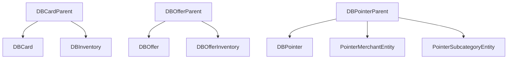
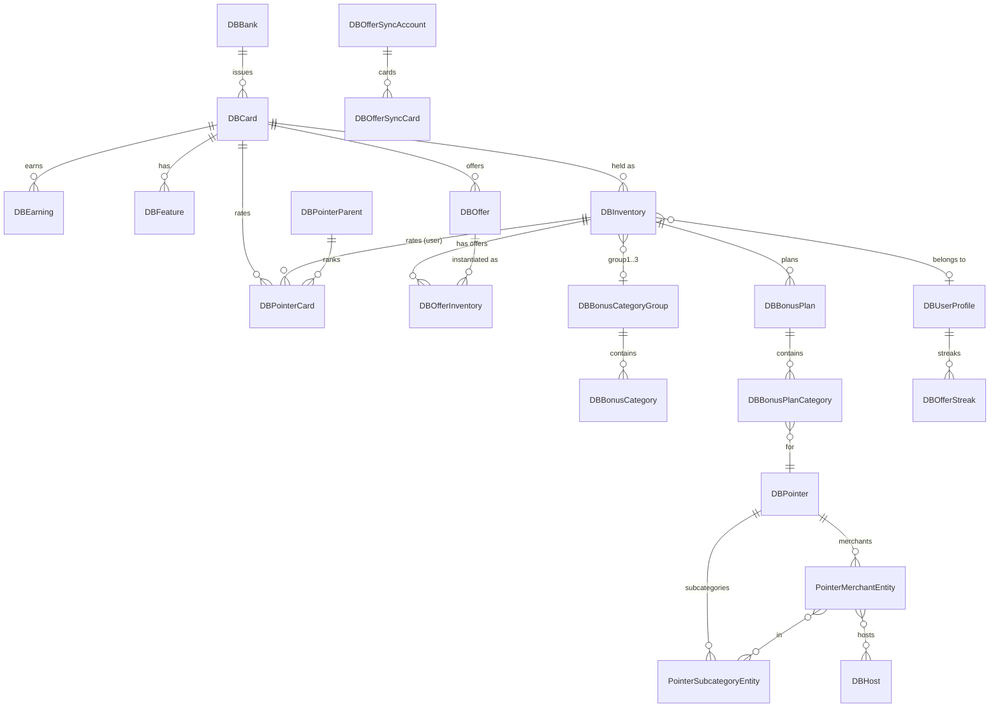

# Phase 7 — Data Storage Analysis

Evidence: `raw/coredata-model.txt` (model dumped by loading `coredata.mom` through `NSManagedObjectModel`), `raw/seed-schema.sql`, entitlements, strings.

## 1. Storage locations

| Store | Technology | Location | Shared with |
|---|---|---|---|
| Main database | Core Data (SQLite) — `PersistenceController` in `CardPointersShared` | App-group container `group.getcardpointers.app` (legacy `group.com.emcro.CardPointers`) | Widgets, Intents ext., Menu-bar helper |
| Seed database | `cp_seed.sqlite` (Core Data format, `Z_*` tables) | App bundle (read-only), copied/merged on first launch | — |
| Preferences | `UserDefaults` (standard + app-group suite) / `@AppStorage` | `~/Library/Containers/com.getcardpointers.app/…/Preferences` | Extensions via suite |
| Secrets | Keychain (`KeychainItem`) | access group `489M9V6472.com.getcardpointers.app` | — |
| Menu bar snapshot | JSON (`CardPointersMenuBarSnapshot`) | App-group container | Menu-bar helper |
| Location reminders | `UNLocationNotificationTrigger` + local cache (`CachedNearbyLocation`, `HiddenNearbyStore`) | On-device only | — |
| Spotlight index | CoreSpotlight (`SpotlightSearchItemType`) | System | — |

## 2. Core Data model (24 entities)

Inheritance (Core Data entity inheritance → single table per root):

| Entity | Role | Key attributes |
|---|---|---|
| `DBBank` | Issuer | id, name, country_code, weight |
| `DBCard` ⊂ CardParent | Catalog card definition | card_id (req), title, bankName, bank_id, network, fee, value (¢/pt), currency, type (personal/business), bonus/bonusNum, spend/spendNum, months, popular, top10, sponsored, affiliate, debit, foreignFees, url_mobile, url_rates, reconsideration, phone, slug, country_code |
| `DBInventory` ⊂ CardParent | **A card the user holds** | id, status (Int16), cardholder (Int16), approvedDate, closedDate, earnedBonus, nickname, notes, profile_uuid, external_id, offer_sync_account_id, userNetwork, boaTier, sort_order, recurring_{favorite,redeem,delete}_checklists (Transformable) |
| `DBEarning` | Earning rule | name, category_name, points (Float), icon, symbol, sort_order |
| `DBFeature` | Card benefit text | name, weight, sort_order |
| `DBBonusCategoryGroup` / `DBBonusCategory` | Choose-your-category groups (e.g., 5 % rotating) | title, points, frequency; selected category per inventory (slots 1–3) |
| `DBBonusPlan` / `DBBonusPlanCategory` | Custom spend plans | name, duration, start/end_date, is_default, is_editable; categories {pointer_id, value, spend} |
| `DBOffer` ⊂ OfferParent | Catalog/bank offer | id, title, subtitle, terms, value, start, end, type, grade, frequency, is_repeatable, max_times, bonus_points, total_points, discount_percent, discount_max, url, slug, ai_terms_summary(+hash) |
| `DBOfferInventory` ⊂ OfferParent | **Offer attached to a user card** | offer_id, checked, redeemed_date, total_used, times_used, hide_until (snooze), is_signup, is_backfilled, external_id, recurring_key, auto_{favorite,redeem,delete}, cardholder, created, sort_order — index `offersDefaultSort` |
| `DBOfferStreak` | Weekly activity | week, num_offers, num_payloads, timestamp, profile_uuid |
| `DBOfferSyncAccount` | Bank login for Offer Sync | id (UUID), bank (default `americanExpress`), bank_id, label, is_active, added_at |
| `DBOfferSyncCard` | Card discovered at bank | id (UUID), account_id, external_id, last_digits, name, inventory_id |
| `DBOfferSyncHistory` | Sync run log | id (UUID), account_id, bank_name, cards_count, offers_added, status (`completed`), sync_type (`automatic`), error_message, synced_at |
| `DBPointer` ⊂ PointerParent | Spending category | id, name, symbol, icon, color, feature, hidden, is_favorite, is_popular, offer_ids, pinned_id, top_inventory_id |
| `PointerMerchantEntity` ⊂ PointerParent | Merchant | id, name, subcategoriesCount; hosts (web domains) |
| `PointerSubcategoryEntity` ⊂ PointerParent | Subcategory | id, name, other, offer_ids, other_offer_ids |
| `DBPointerCard` | **Earning rate of a card in a category/merchant** | card_id, inventory_id, pointer_id, merchant_id, subcategory_id, points, total_value, order, pinned, sponsored, feature |
| `DBHost` | Merchant web host | name |
| `DBUserProfile` | Household profile (P2) | uuid, nickname, email, isAccepted, sortOrder |

Transformable attributes: `offer_ids`, `other_offer_ids`, `recurring_*_checklists` (arrays).
Delete rules: mostly Nullify (1); Cascade (2) from `DBInventory → offerInventories/pointerCards`, `DBUserProfile → inventories/offerInventories/offerStreaks`, `DBOfferSyncAccount → cards`.

## 3. ER diagram

## 4. Seed SQLite physical schema

Core Data's SQLite mapping: `ZDBCARDPARENT` (Z_ENT 6/7/8 for parent/card/inventory), `ZDBOFFERPARENT` (12/13/14), `ZDBPOINTERPARENT` (20/21/22/23), join tables `Z_11MERCHANTS` (hosts↔merchants), `Z_12POINTERS`, `Z_13POINTERPARENTS`, `Z_14INVENTORYPOINTERS`, `Z_14OTHERPOINTERSUBCATEGORIES`, `Z_22SUBCATEGORIES`, plus `Z_PRIMARYKEY`, `Z_METADATA`, `Z_MODELCACHE`. Full DDL: `raw/seed-schema.sql`.

Business rule recovered from seed data: **`DBPointerCard.total_value = points × card.value`**, where `value` is the card currency's cents-per-point valuation. Examples: Amex 4X MR × 2.0 = 8.0; Capital One 10X × 1.7 = 17.0; 5 % cash × 1.0 = 5.0. Gas "25 ¢/gal" is stored as points 25, total_value 8.33 (normalized).

## 5. UserDefaults (selected keys)

| Key family | Examples |
|---|---|
| Dashboard layout | `dashboardSection`, `dashboardShortcutsOrder`, `dashboardPointerSize`, `dashboardPointerNames`, `dashboardPointerSubcategories`, `dashboardOffersAutoHide`, `dashboardCardsOverview`, `dashboardCardsNoFeeRenewals`, `dashboardChaseStatus`, `dashboardPinnedCard`, `dashboardFavorites`, `dashboardAutoPilot`, `dashboardAugmentedReality`, `dashboardWizard` |
| Wallet state (`WalletStore`) | `isPaidSubscriber`, `proExpirationDate`, `proLifetime`, `proWillRenew`, `memberSinceYear`, `isTipper`, `partnerCode`, `countryCode`, `languageCode`, `top10CardIds`, `pointerFavorites`, `cards524`, `userSignedOut`, `rebuiltStoreTimestamp` |
| Notifications | `notificationNewOffers`, `notificationCardChanges`, `notification524Status`, `notificationFavoriteOffersOnly` |
| Paywall remote config | `paywallShowAfterLogin`, `paywallButtonTitle`, `paywallShowSkip`, … (22) |
| Misc | `hideTopNewOffersForMonth`, `com.getcardpointers.app.lastViewedCategory`, Settings.bundle `user_identifier`, `reset_preference` |

## 6. Keychain usage

- `userToken` (API bearer). Log string: *"*** Unable to save userToken to keychain."*
- `OfferSyncAccountCredentials{username, password}` per bank account (Offer Sync), on-device only.
- RevenueCat / PostHog SDK identifiers.
- `KeychainItem.Accessibility` enum shows configurable `kSecAttrAccessible*` levels.

## 7. Observations

- Offline-first design: the full catalog ships in the bundle and the API sends deltas.
- Household support (profiles) flows through `profile_uuid` on inventory, offers and streaks.
- Sensitive bank credentials never reach the backend (consistent with marketing claims and with the absence of credential fields in any API model).
