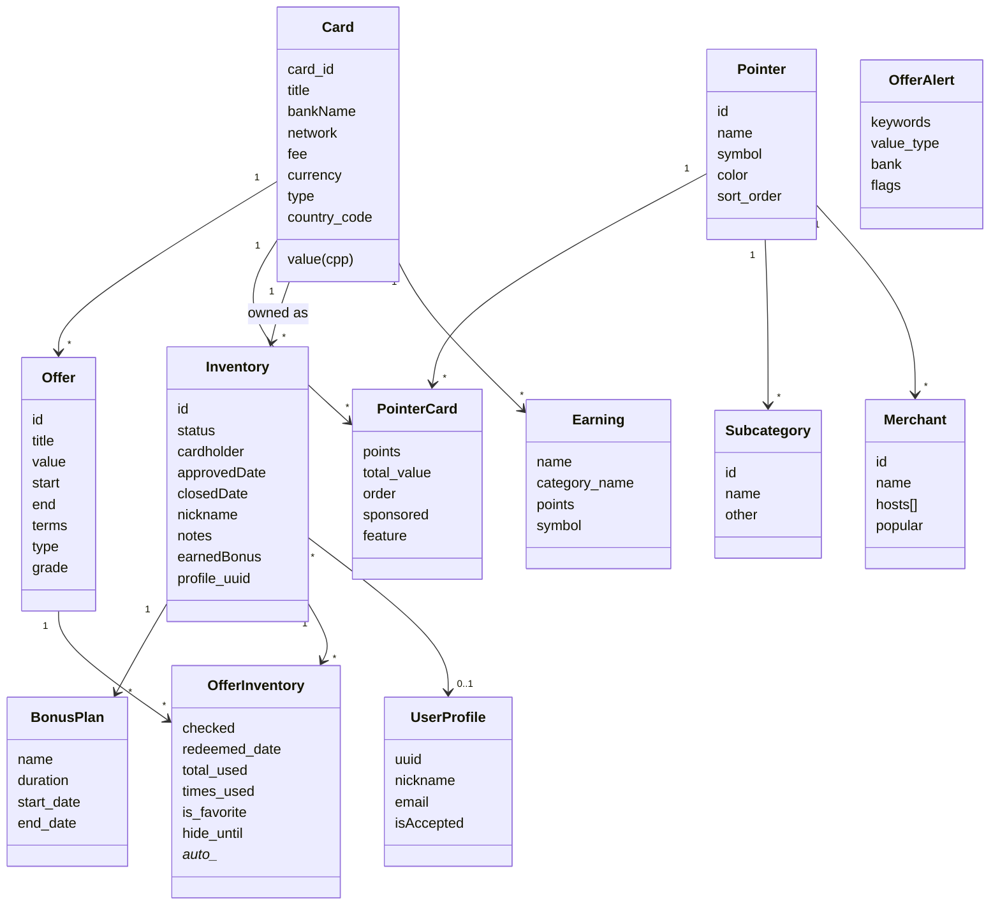
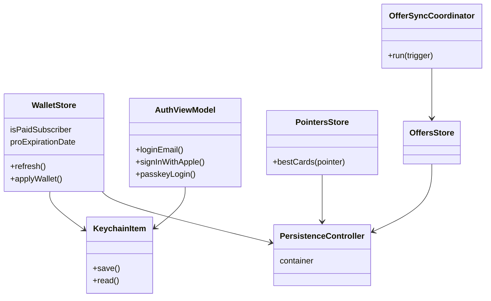

# Phase 4 — Swift Analysis

Swift was detected: 1,348 app-owned nominal types across `CardPointers` and `CardPointersShared`.

## 1. Method

`swift-reflection-dump` is not shipped with Xcode 27.2, so two small parsers were written (Python, stdlib only):

1. **`swifttypes.py`** — walks `__swift5_types` / `__swift5_protos` relative pointers to each *context descriptor*, reads `flags & 0x1f` (kind: 16 class, 17 struct, 18 enum, 3 protocol) and the name / parent chain → `raw/swift-types.tsv`.
2. **`swiftfields.py`** — walks `__swift5_fieldmd` *field descriptors* (`mangledTypeName`, `kind`, `fieldRecordSize`, `numFields`, records of `flags / mangledTypeName / fieldName`), resolving `\x01` symbolic references to context descriptors → `raw/swift-fields.tsv`.

Mangled type tokens in field types decode as: `SS` String, `Si` Int, `Sf` Float, `Sd` Double, `Sb` Bool, `Sg` Optional, `Say…G` Array, `SDy…G` Dictionary, `<ind>` indirect ref (often `Date` or another module type). `xcrun swift-demangle` was used for ObjC-visible names (`_TtC12CardPointers…`).

## 2. Architecture pattern

SwiftUI app with **ObservableObject stores** (MVVM-ish, "Store" naming) + Core Data via `PersistenceController` in a shared module consumed by widgets/extensions. Concurrency via async/await; background work via `BGTaskScheduler` (iOS) or a `ServiceManagement` login item (Mac).

## 3. View models / stores (`ObservableObject` classes)

| Store | Responsibility (inferred from name + fields) |
|---|---|
| `WalletStore` | Root sync: `/me`, `/wallet`, token refresh gate, payload digest diffing, paywall flags, subscription status (`_isPaidSubscriber`, `_proExpirationDate`, `_proLifetime`), notification prefs, tips (tiny→humongous), partner code, country/language, `pointerLocations`, offer alerts, top10, cards524 |
| `AuthViewModel` | Email login, Sign in with Apple, passkey sign-in/up |
| `CardStore` | User cards (inventory) CRUD, ordering |
| `OffersStore` / `OffersSummaryStore` / `ExpiringOffersStore` / `AddOfferStore` | Offer list, totals, expiring soon, add/edit custom offers |
| `OffersInventoryFilterStore` | Filters per card/profile |
| `PointersStore` | Categories & merchants, best-card ranking |
| `ProfileStore` | Household profiles (P2) |
| `OfferStreakStore` | Weekly "offer streak" gamification |
| `CardRenewalsStore` | Annual-fee renewal reminders |
| `AccountSummaryStore` | Account summary (e.g., Chase overview) |
| `OfferAlertListViewStore` | Keyword alerts for new offers |
| `ProLinkStore` | Link a purchase made on web to the account |
| `MainLayoutStore`, `NavigationStore`, `SheetRouter` | Navigation |
| `AppCommands{Cards,Offers,Pointers}Store` | macOS menu commands |
| `SharedWithYouViewModel`, `IslandModel`, `ShoppingLiveActivityModel` | System integrations |
| `LocationManager`, `BackgroundLocationManager` | Nearby + geofenced reminders |
| `CardSemanticSearch`, `CardLexicalSearch` | Card search (NaturalLanguage embeddings + lexical) |

## 4. Controllers (UIKit / AppKit)

`ViewController`, `ARViewController` (+ `ARPresenter`, `ARTrackingManager`, `RadarMapView`) — AR "point your phone at stores" view; `AmexWebViewController`, `OfferBankWebViewController` (WKWebView hosts for Offer Sync); `PencilViewController`; `SiriShortcutViewController`; `ParentResolverViewController`; `CarPlaySceneDelegate`.

## 5. Services

| Service | Role |
|---|---|
| `OfferSyncCoordinator`, `OfferSyncSessionRuntime`, `OfferSyncAccountManager` | Orchestrate bank sessions (Amex, Chase, Citi, BoA, US Bank, Wells Fargo) |
| `OfferSyncBackgroundScheduler` / `…Runner` / `…ContinuedProcessingManager` / `OfferSyncMacService` | Scheduled runs (`OfferSyncSchedule`, `OfferSyncWeekday`), BGContinuedProcessingTask |
| `OfferSyncCardMappingStore` | Map bank card (`external_id`, `last_digits`) → user inventory card |
| `OfferChangeSaveQueue`, `PendingOfferChanges` | Debounced batching of offer edits to the API |
| `CPAnalyticsService` | PostHog wrapper |
| `PersistenceController`, `CoreDataHelper` | Core Data stack in the app group |
| `KeychainItem` | Token storage (`Accessibility`, `KeychainError`, `ReadResult`) |
| `TemplateManager` | Offer templates (`OfferTemplate`, `TemplateField`) |
| `MenuBarSnapshotCoordinator` / `CardPointersMenuBarSnapshotStore` | Writes JSON snapshot for the menu-bar helper |

## 6. Business objects & data models (API — `CardPointersShared`)

| Model | Fields |
|---|---|
| `User` | message, generated_password, id, profiles[Profile] |
| `Profile` | uuid, sort_order, nickname, email?, is_accepted |
| `Wallet` | cards_user[Card], cards_sponsored, cards_popular, pointers_user[Pointer], offers_user[Checklist], top10, status_524, offer_alerts, favorite_pointers[String], merchants[Merchant], cards_524[Int] |
| `Card` (user card) | card_id, bonus, phone, reconsideration, months, fee, title, color, value, foreignFees, spend, createdDate, approvedDate, inventory, external_id, status, earned_bonus, sort_order, nickname, url_mobile, features[Feature], earnings[Earning], bankName, affiliate, website, available, bonus_category_group1..3, pdp, cardMatch, currency, original_value/title/color, notes, network, userNetwork, type, weight, bonusPlans, selectedBonusPlan, applicationNotes, bank_id, url_rates, country_code, updatedTime, closedDate, slug, profile_uuid, boaTiers, boaTier, cardholder, debit, recurring_{favorite,redeem,delete}_checklists |
| `SimpleCard` | card_id, title, nickname, bankName, color, inventory, original_title, num_inventories, weight |
| `Earning` | points, icon, symbol, category_name, name |
| `Feature` | name, weight |
| `Pointer` (category) | id, icon, symbol, color, cards[PointerCard], sort_order, top_card_id, name, feature, topCard, subcategories, offer_ids, pinned_id, top_inventory_id |
| `PointerCard` | points, total_value, feature, sponsored, card_id, card, color, order, inventory_id |
| `APIPointerSubcategory` | id, name, cards, other, offer_ids, other_offer_ids, pinned_id |
| `Merchant` | id, name, category, subcategories, ci_ids, cards, hosts[String], user, popular, pinned_id |
| `Checklist` (offer on a card) | 47 fields — id, external_id, title, subtitle, checked, value, start, end, redeemed_date, inventory_id, card, is_repeatable, total_available, total_used, type, is_signup, is_backfilled, hide_until, category_ids, bank_id, is_min, terms, offer_id, recurring_key, frequency, standard, bonus_points, total_points, discount_percent, discount_max, url, max_times, times_used, slug, is_favorite, smart_ids, cardholder, created, grade, user_grade, custom, custom_bonus_type, custom_amount_value, custom_is_bonus_limited, custom_bonus_limit_value |
| `OfferAlert` | id, title, keyword_type, keywords, value_type, grade_type, bank_type, amex/boa/chase/citi/wells_fargo/us_bank flags, auto_favorite, is_active |
| `NotificationMessage` | id, title, subtitle, body, timestamp, is_local, is_read, is_linked, offer_alert_ids, card_ids, inventory_ids, offer_ids, offer_inventory_ids |
| `BonusPlan` / `BonusPlanCategory` | spend plans (id, name, duration, dates, categories{pointer_id, value, spend}) |
| `BonusCategoryGroup` / `BonusCategory` | rotating/choice categories (title, points, frequency, selected) |
| `OfferStreak` | iso_week, iso_timestamp, num_payloads, num_offers |
| `Top10` / `Top10Card` / `Status524` | best-offers leaderboard; Chase 5/24 count + date |
| `Paywall` | 22 remote-config flags for the paywall UI |

App-module DTOs: `AuthResponse{success, token, email}`, `EmailLoginResponse{code, message, token}`, `MeResponse{data: MeDataResponse{email, updated, newest_card, newest_offer, newest_message, newest_merchant, newest_offer_inventory_id, success}}`, `PasskeyResponse{challenge, token, credential_id, existing_credential_ids…}`, `InstallResponse{code}`, `OfferStreakResponse`, `SuccessResponse{success, inventory_id, refresh, bank_id, offer_alert_id, message}`, `NewestOffersResponse{offers, added_count}`, `ManageLinkResponse{url, store}`, `LinkPurchaseResponse`.

## 7. Networking code

`URLSession` + `JSONDecoder` with `CodingKeys` (snake_case). Bearer token from Keychain; `WalletTokenRefreshGate` (actor-like class) serializes 401 → refresh → retry. Delta sync via `?since=` / `?since_id=` query params and `MeDataResponse.newest_*` watermarks. Details in networking.md.

## 8. Apple Intelligence (FoundationModels)

`@Generable` types (have `PartiallyGenerated` companions): `BestCardStruct`, `CardStruct`, `CardsQuery`, `InventoryStruct`, `OfferInventoryStruct`, `OffersQuery`, `IntelligenceOutput`, `SpotlightSearchResult`, `OfferAIParseResult`.
Tools exposed to the model: `AllCardsTool`, `FindCardTool`, `QueryCategoryTool`, `SearchPointersTool`, `SpotlightSearchTool`, `SuperTool`. `AskAIModelPreference`/`AskAIResolvedModel` choose on-device vs Private Cloud Compute. `OfferAIParseResult` turns pasted offer text into structured fields (title, dates, category IDs, bonus, spend, discount).

## 9. UML — core domain

