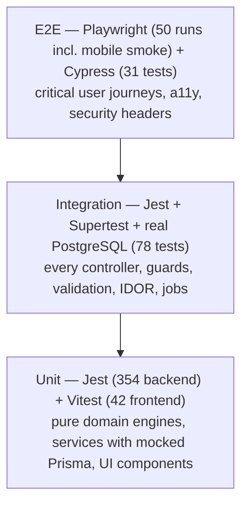
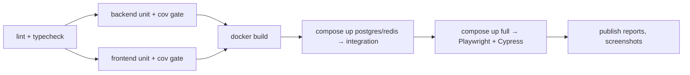

# Phase 17 — Test Strategy

## 1. Test pyramid

| Layer | Tool | Location | Runs against | Command |
|---|---|---|---|---|
| Backend unit | Jest + ts-jest | `backend/test/unit` | mocked Prisma | `npm run test:cov` |
| Backend integration | Jest + Supertest | `backend/test/integration` | Postgres `pointwise_test` (migrate + seed in globalSetup) | `npm run test:integration` |
| Frontend unit | Vitest + Testing Library (jsdom) | `frontend/test` | — | `npm run test:cov` |
| E2E (primary) | Playwright 1.49 + axe-core | `playwright/tests` | full compose stack | `docker compose --profile e2e run --rm e2e` |
| E2E (secondary) | Cypress 13.17 | `cypress/cypress/e2e` | full compose stack | `docker compose --profile cypress run --rm cypress` |

## 2. Coverage goals and current results

| Scope | Goal | Measured (2026-11-21) |
|---|---|---|
| Backend domain (`src/domain`) — business rules | ≥ 95 % lines (enforced threshold) | **100 % lines, 99.5 % branches** |
| Backend whole codebase (integration run) | ≥ 85 % lines | **91.3 % lines** (88.8 % statements, 59.9 % branches*) |
| Backend unit run (services + domain) | informative | 67.7 % lines (controllers and query-only services are covered by integration) |
| Frontend unit-testable modules (lib, ui kit, login form) | ≥ 80 % lines (enforced) | **94.5 % lines, 96 % branches** |
| New portfolio engines (`five24`, `benefits`, `portfolio`, `import`) | ≥ 95 % lines (requirement) | **97–100 % lines** (five24 100, portfolio 100, import 100, benefits 97) |
| Backend whole codebase after the revision (integration run) | ≥ 85 % lines | **88.2 % lines** (Plaid / push / delivery code is exercised by unit tests with fakes because no provider keys exist in CI) |
| Frontend unit scope incl. `lib/portfolio.ts`, `components/charts.tsx` | ≥ 80 % lines | **96.6 % lines, 97.6 % branches** |
| Critical-path E2E | 100 % of P0 journeys | **100 % executed and passing**: Playwright 44/44 and Cypress 28/28 after the revision (2 consecutive runs each); originally 36/36 and 22/22, in Docker (see docker-validation.md) |

\* Branch coverage in integration runs is depressed by decorator metadata (`class-validator`/Swagger generate many unreached branches). The project-wide 95 % target is met for the business logic, where it matters. Raising it further for controllers needs more negative-path integration tests (backlog item T-12).

## 3. Test types

### Unit tests
- Pure domain: ranking precedence, rotating activation, valuations, pins, ties; calculator math, validation and limits; 5/24 window edges; anniversaries (leap year, month-end); bonus risk; offer usage rules (amount caps, repeatables, start/expiry, auto-redeem), snooze bounds, sorting, alert matching; geo math; plan entitlements.
- Services: auth (hashing, token rotation, reuse detection, OAuth linking, reset), wallet (limits, ownership, reorder, pins), offers (limits, eligibility, custom validation, enrichment), subscriptions (mock provider, cancel/resume rules), notifications (dedupe), jobs (each job, digest partial failure).
- Frontend: formatting, validation, open-redirect guard, API client errors, UI components (a11y roles), login form.

### Integration tests
Real HTTP through the full Nest pipeline (guards, pipes, filters) and a real Postgres. They cover authN/authZ, validation (400), conflicts (409), business rules (422), plan gating (403), IDOR (403), idempotent jobs, admin audit, privacy export/delete. They are hermetic: every test registers fresh users, and the suite passes on consecutive runs against the same DB.

### End-to-end tests
Browser journeys through Next.js → proxy → API → DB: sign-up, login, logout, callback safety, wallet CRUD, rotating categories, best card, pinning, merchant search, nearby (demo location and geolocation permission), calculator, offers lifecycle, notifications via job, subscriptions, admin, data export/delete. Screenshots are written to `screenshots/`.

### Security tests
| Test | Where |
|---|---|
| Auth required on protected routes (401) | INT, CY-AUTH-05 |
| Role enforcement (403 / redirect) | INT admin RBAC, PW-AUTH-08 |
| IDOR on wallet cards, offers, filters | INT |
| Mass assignment (`role` in register body → 400) | INT |
| Refresh token reuse detection | unit + INT |
| No account enumeration (login message, forgot-password) | INT, PW-AUTH-04/07 |
| Open redirect via `callbackUrl` | Vitest, PW-AUTH-06 |
| XSS vector `javascript:` URL rejected | INT |
| PAN rejection (`lastFour`) | INT, PW-WAL-02 |
| Security headers / CSP / no `x-powered-by` | PW-SMK-03 |
| Secrets not exported (`passwordHash`) | INT |
| Dependency audit | `npm audit --omit=dev` in CI (see security-review.md) |

### Performance tests
k6 scripts (backlog, Phase 2 Beta): `GET /recommendations/categories/:slug` at 200 RPS, p95 < 100 ms; `/dashboard` p95 < 250 ms; `/cards?q=` p95 < 150 ms. Domain micro-benchmark: ranking 50 cards × 16 categories runs in under 1 ms (pure functions). See performance-review.md.

### Accessibility tests
axe-core (WCAG 2 A/AA, serious and critical impacts fail) on all public and authenticated pages (PW-SMK-01/02), on desktop and a Pixel 7 viewport. Component tests assert roles (`alert`, `status`, `progressbar`, labelled inputs).

### Regression tests
- Every fixed defect gets a test (e.g. admin PATCH partial DTO → INT "admin CRUD"; job test hermeticity → INT "notifications & jobs").
- The full suite runs on every PR (CI). Nightly: E2E on both browsers' projects plus Cypress.
- Visual: Playwright screenshots archived per release for manual diffing (automated visual diff is in the roadmap).

### AI platform suites
- Unit `test/unit/ai/`: provider adapters with fake SDK clients (request shapes incl. Claude effort / fallbacks / caching / no forced tool choice, response parsing, error → retryable mapping), router failover + circuit breaker + cost, mock model rules, runtime (refusal, step limit, tool errors, external MCP tools, pending actions), MCP URL policy / hashing / refresh, MCP server over an in-memory transport, PATs.
- Integration `ai.int-spec.ts`: consent, the spec questions on the family account, task endpoints, confirm-before-write, budgets, IDOR, admin keys/models/agents/usage, `/mcp` over real HTTP with PATs, admin registering an MCP server (approval pinning).
- E2E: `playwright/tests/ai-assistant.spec.ts` (6), `cypress/cypress/e2e/ai-assistant.cy.ts` (3).
- **No test calls a paid model**: the test env deletes provider keys and uses the deterministic offline model. A live-provider smoke test is manual (TC-AI-34).
- Coverage (AI layer): providers 100 % lines, router 100 %, MCP client 100 % (unit); service 88 %, admin controller 97 %, tools 79 %+ (integration).

### Phase H additions (spend tracking, automatic benefits)
Unit (`spend/spend.spec.ts`, 14): descriptors, classification, bank/Plaid categories, statement parsing (Chase/Amex/debit-credit layouts, sign detection and override, stable dedupe keys, errors), suggested/sanitised rules, matching (keyword > category, credits by longest word, word boundaries), merchants. Connections (+3): Plaid `/transactions/sync` mapping, sync into spend tracking (pending/unknown accounts skipped, removed deleted, cursor), failure isolation. Integration (`spend.int-spec.ts`, 10): preview without saving, import → expected then confirmed, duplicates, list/summary, dismiss + rescan, manual credit, custom rules/reset/off, delete cascade, validation and ownership. Frontend `spend.test.ts`; Playwright PW-SP-01 (+ smoke `/spending`); Cypress CY-SP-01.

### Phase G additions (card research, real catalog)
Unit (`card-research.spec.ts`, 16): payload normalisation (off-domain/http/nameless/duplicate cards, unknown categories, rate ranges), evidence checks against the fixture page (quote present and states the value; typography; quotes from instruction-like injected text rejected), catalog matching, provider server tools (Claude `web_search`/`web_fetch` mapping, `pause_turn`, pages, server usage; OpenAI refuses), the demo model's fixed research answer, and consistency of the curated real-card data. Integration (`card-research.int-spec.ts`, 7): admin-only, validation, DISCOVER → job → PARTIAL candidate with dropped facts, approval creates card/issuer/currency/rates/source/offer history, VERIFY → change proposal → approval marks verified, UNVERIFIED needs override, verify-unverified queueing, 503 without a web-search model, stale runs failed. Frontend: `verificationBadge`. Real-catalog import exercised in Docker on a scratch database (`SEED_CATALOG=real`). No test calls a paid model.

### Phase F additions
Unit: approval odds and score scaling (`card-scorer.spec.ts`), terms routing in the demo model. Integration (`strategy.int-spec.ts` +4): credit band on a member and its effect, family bands, fine-print search incl. an injection-shaped query (parameterised SQL), transfer-bonus job idempotency and opt-out; eval case EV-16 (fine print, catalog-only). E2E: PW-NC-03, PW-TR-03, CY-TR-02.

### Phases D/E suites (next-card scorer, travel, streaming, evals, operations)
- Unit `test/unit/strategy/` (`card-scorer.spec.ts`, `travel.spec.ts` — domain coverage gate 95 %), `test/unit/ai/streaming.spec.ts` (Claude stream helper with eager tool input, OpenAI chunk accumulation, demo streaming, router reset on mid-stream failover), `runtime.spec.ts` (stream events, max_tokens guard), `evals.spec.ts` (grader).
- Integration `strategy.int-spec.ts` (11: scorer on the family account, who should apply, household plan, spend sources, travel, balances, admin curation), `ops-stream.int-spec.ts` (5: SSE events and errors, ops health/logs, admin-only), `evals.int-spec.ts` (grounding eval set, 15 cases, must pass 100 % on the demo model).
- E2E: `playwright/tests/strategy-travel.spec.ts` (7), `cypress/cypress/e2e/strategy-travel.cy.ts` (3); `/next-card` and `/travel` added to the axe smoke test.
- Opt-in only: `npm run eval` with a real model (`EVAL_LIVE=1`), `npm run test:live` (`LIVE_AI_SMOKE=1`) — never in CI.

### Card knowledge base suites (Phase C)
- Unit `test/unit/catalog/`: `card-extract.spec.ts` (HTML → text, deterministic extraction, evidence validation incl. negated foreign-fee text, merge/disagreement, diff, median/elevated, timeline labels), `fetcher.spec.ts` (issuer allow-list, https-only, robots.txt groups/wildcards, conditional GET, redirect-hop re-validation incl. metadata IP, size/content-type limits, politeness wait, AI extraction sends only public page text, fallback to heuristics).
- Integration `card-refresh.int-spec.ts` (10): sources CRUD + URL policy, refresh from a local fixture issuer site, prompt-injection page yields no $0 fee proposal, approve → card update + offer version close/open + elevated alert, correction/rejection, unchanged page skipped, paste extraction, public offer-history/welcome-bonus/annual-fee APIs, retention reports aggregated anonymously, non-admin 403.
- E2E: `playwright/tests/card-data.spec.ts` (2), `cypress/cypress/e2e/card-data.cy.ts` (2).
- The test fixture site runs on 127.0.0.1 (allowed only via `CARD_SOURCE_HTTP_HOSTS` in the test env); no test fetches a real issuer site or calls a paid model.

### Portfolio revision suites
- Unit: `test/unit/524` (5/24 rules, boundaries, timeline), `test/unit/benefits` (periods, utilization, thresholds, YTD distribution, value analytics, push/delivery), `test/unit/imports` (parsers, matching, CSV, Plaid connector with fake fetch, token crypto).
- Integration: `test/integration/portfolio.int-spec.ts` — households, 5/24 and portfolio on the seeded family account, benefits CRUD/usage/IDOR, alert job idempotency and preferences, import preview/commit/re-import/limits/rejections, credit reports, disabled connectors/push, GDPR export.
- E2E: `playwright/tests/portfolio-benefits.spec.ts` (8), `cypress/cypress/e2e/portfolio-benefits.cy.ts` (6); new pages added to the axe smoke test.
- Fixture: `backend/test/fixtures/tracker.ts` — synthetic look-alike of the tracker workbook (the owner's file is never used).
- Isolation: integration tests use Redis DB 1.

## 4. Environments & data

| Env | DB | Data |
|---|---|---|
| Unit | none | fixtures (`test/unit/fixtures.ts`) |
| Integration | `pointwise_test` (separate DB created by `docker/postgres/init-test-db.sql`) | migrate + idempotent seed; tests create unique users |
| E2E | compose `pointwise` DB | seed (fictional catalog, demo + admin users); tests create unique users |

## 5. Entry / exit criteria

- **Entry:** build green, migrations apply cleanly.
- **Exit (release):** 0 failing tests; domain coverage ≥ 95 %; no serious or critical axe violations; no high or critical `npm audit` findings in production dependencies; all P0 test cases pass.

## 6. CI pipeline (recommended)

## 7. Requirement → test traceability

| Requirement | Unit | Integration | E2E |
|---|---|---|---|
| FR-1 register/login/OAuth | auth.service.spec | auth suite | PW-AUTH-01..05, CY-AUTH-01..04 |
| FR-2 token lifetime & rotation | auth.service.spec (refresh) | register→refresh→logout | — |
| FR-3 catalog search | — | catalog suite | CY-SRCH-01..04 |
| FR-4 duplicate cards allowed | — | wallet suite | — |
| FR-5 status gating | recommendation.engine.spec | — | CY-CARD-02 |
| FR-6 ranking precedence | recommendation.engine.spec | wallet/recommendations suite | PW-REC-01..03, PW-WAL-04, CY-RWD-01/02 |
| FR-7 valuation override | recommendation.engine.spec | valuation override test | — |
| FR-8 offer tracking rules | offers.spec, services.spec | offers suite | PW-OFF-01..03, CY-OFF-01..03 |
| FR-9 expiring window | offers.spec, JobsService | jobs suite | PW-NOT-01 |
| FR-10 bonus progress | insights.spec | transactions/dashboard | dashboard screenshots |
| FR-11 renewals | insights.spec | jobs suite | — |
| FR-12 5/24 | insights.spec | dashboard | — |
| FR-13 calculator | calculator.spec | calculator test | PW-REC-06, CY-RWD-03, PW-SUB-01 |
| FR-14 nearby | geo-entitlements.spec | nearby test | PW-REC-04/05 |
| FR-15 notifications | services.spec (Jobs, Notifications) | jobs suite | PW-NOT-01/02, CY-NOT-01/02 |
| FR-16 plan limits | geo-entitlements.spec, services.spec | free limit, plan gating | PW-WAL-03, PW-SUB-01/02, CY-SUB-01/02 |
| FR-17 admin + audit | — | admin RBAC & audit | PW-ADM-01, PW-AUTH-08 |
| FR-18 export/delete | — | privacy suite | PW-PRIV-01 |
