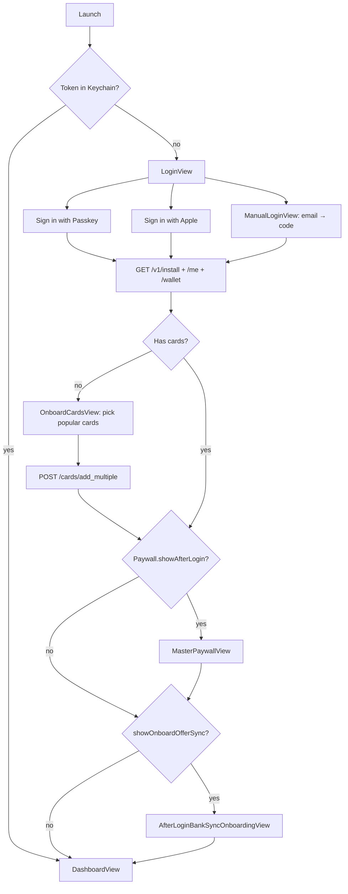
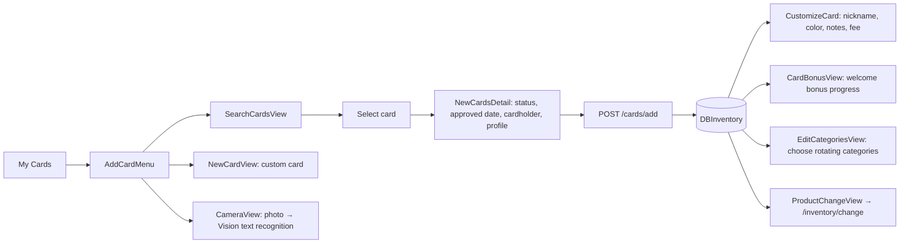
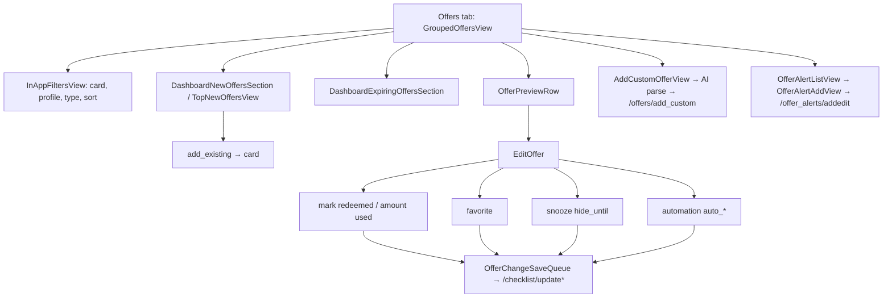
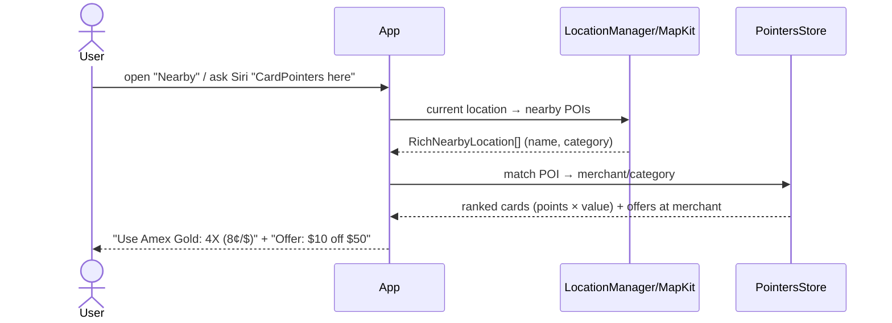
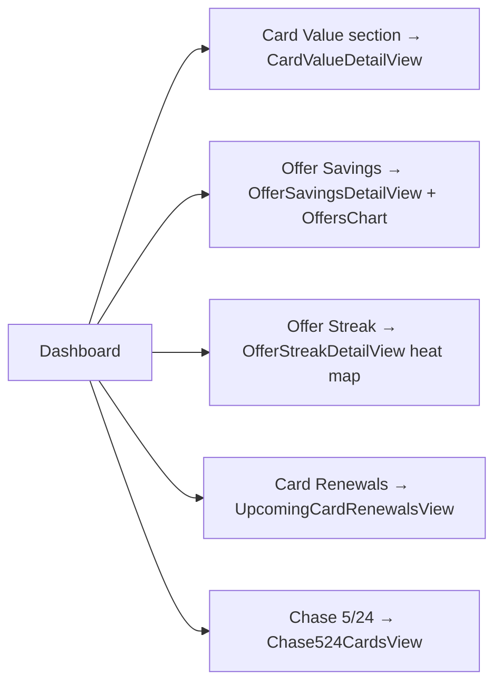
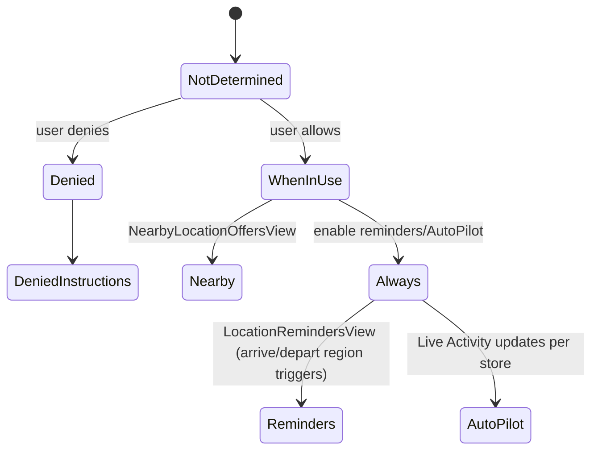
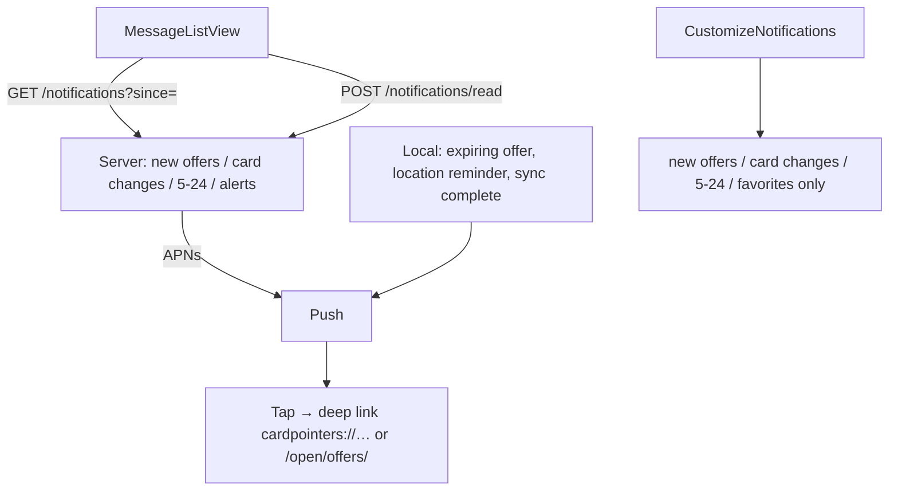
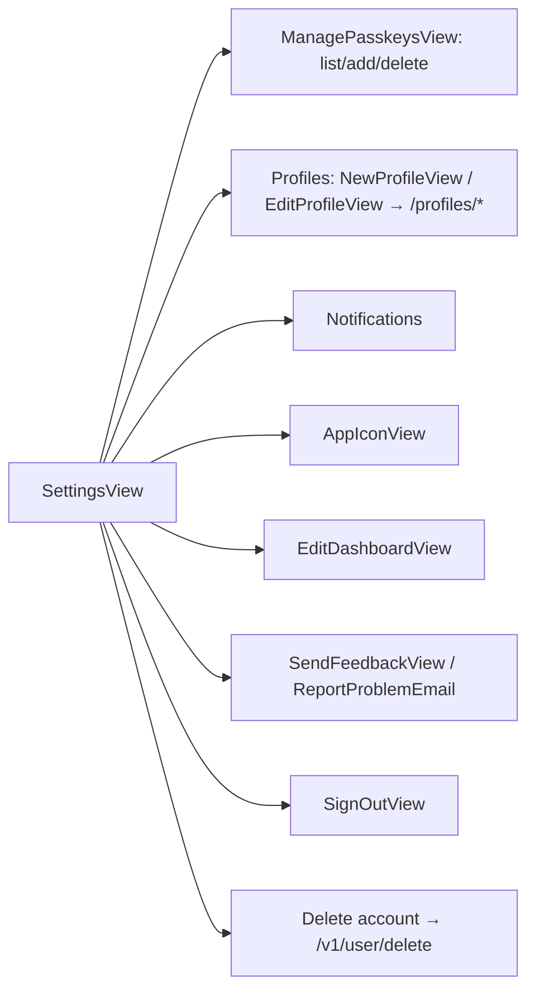

# Phase 9 — User Flow Analysis

Flows reconstructed from SwiftUI view names, store names, App Intents and endpoints. Screen names in `code` are recovered type names.

## 1. Onboarding



## 2. Card setup



## 3. Offer discovery & tracking



## 4. Best card at a place (rewards usage)



## 5. Rewards tracking



## 6. Location services



## 7. Notifications



## 8. Subscriptions

```mermaid
flowchart TD
  G[Gated feature tapped / GateOffer] --> PW[MasterPaywallView]
  PW --> PL{Plan}
  PL --> MO[Monthly] & AN[Annual + trial TrialTimelineView] & LT[Lifetime]
  MO & AN & LT --> RC[RevenueCat purchase → StoreKit]
  RC --> ENT[Entitlement active → WalletStore.isPaidSubscriber]
  PW --> RS[Restore purchases]
  PW --> LINK[ProLinkView: link web purchase → /purchase/link]
  SET[ProSettingsView] --> MAN[/manage/link/ → manage subscription]
  PW --> TIP[TipJarView: tiny…humongous tips]
```

## 9. Account management



## 10. Web-app equivalents (traceability)

| Native flow | Web route |
|---|---|
| LoginView / ManualLoginView | `/login`, `/signup` |
| DashboardView | `/dashboard` |
| My Cards / SearchCardsView | `/wallet`, `/wallet/add` |
| Offers | `/offers` |
| Nearby | `/nearby` |
| Merchant/Pointer detail | `/merchants/[id]`, `/categories/[id]` |
| CardValueDetailView | `/calculator` |
| SettingsView | `/settings` |
| (server-side) | `/admin` |
