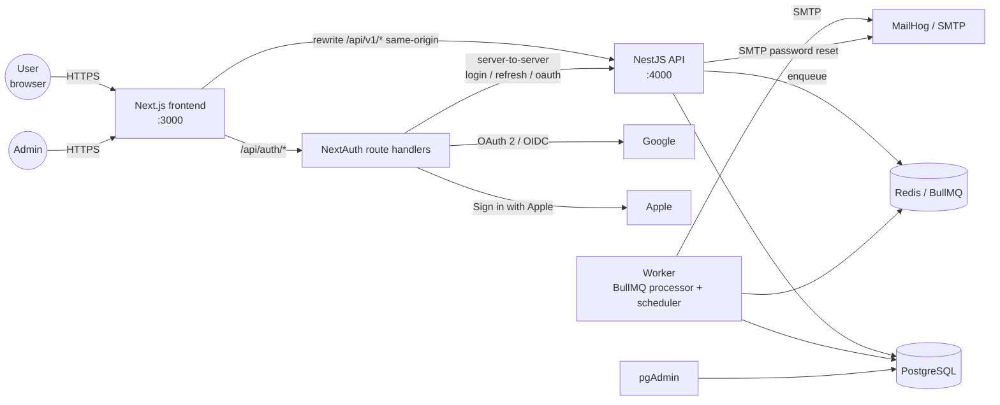
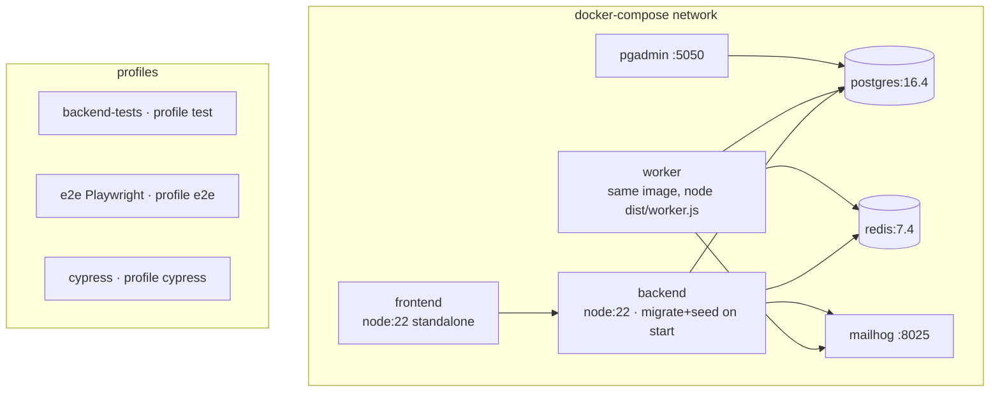
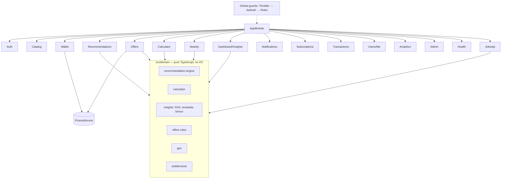
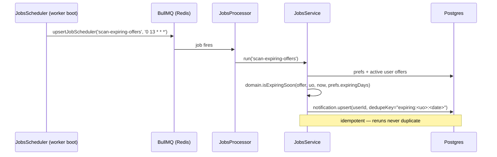
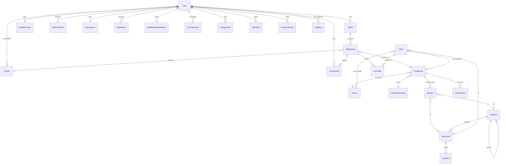

# Phase 11 — Web Application Architecture (Pointwise)

## 1. Stack (as built)

| Layer | Technology | Version (resolved) |
|---|---|---|
| Frontend | Next.js App Router, React, TypeScript, Tailwind CSS, TanStack Query | Next 15.5, React 19, TS 5.7, Tailwind 3.4, Query 5 |
| Auth (web) | NextAuth v4 — Credentials, Google, Apple (enabled by env) | 4.24 |
| Backend | NestJS, Prisma ORM, class-validator, Swagger | Nest 11, Prisma 6 |
| Database | PostgreSQL | 16.4 |
| Cache / queue | Redis + BullMQ | Redis 7.4, BullMQ 5 |
| Email | Nodemailer → MailHog (dev) / SMTP provider (prod) | |
| Infra | Docker, Docker Compose | Compose v2 |
| Docs | OpenAPI 3 (Swagger UI at `/api/docs`) | |

## 2. System context



## 3. Container / deployment view



## 4. Backend module structure



**Key design choice:** all business rules live in `src/domain/*` as pure functions (100% unit-test line coverage). Nest services only load data, call the domain, and persist.

## 5. Data flow — best card for a merchant

```mermaid
sequenceDiagram
  participant B as Browser (merchant page)
  participant N as Next.js (rewrite)
  participant A as API RecommendationsService
  participant D as domain.rankCards
  participant P as Postgres
  B->>N: GET /api/v1/recommendations/merchants/freshcart (Bearer)
  N->>A: proxy (X-Forwarded-For)
  A->>P: merchant + category; wallet cards + rewards + currency; valuations; pins; fallback category
  A->>D: rankCards(cards, {merchantId, categoryId, parent, fallback}, {valuations, pinned})
  D-->>A: ranked[] (¢/$ = multiplier × cpp)
  A->>P: user's active offers at merchant
  A-->>B: { merchant, ranked, offers }
```

## 6. Sequence — authentication (credentials + refresh)

```mermaid
sequenceDiagram
  participant B as Browser
  participant NA as NextAuth (Next server)
  participant API
  B->>NA: signIn('credentials', email, pw)
  NA->>API: POST /auth/login
  API-->>NA: {accessToken(15m JWT), refreshToken(opaque), user}
  NA-->>B: httpOnly encrypted session cookie (JWT strategy)
  B->>NA: useSession() → accessToken
  B->>API: /api/v1/* Authorization: Bearer
  Note over NA: on jwt() callback when access token is near expiry
  NA->>API: POST /auth/refresh (rotation)
  API-->>NA: new pair (old revoked; reuse → family revoked)
```

OAuth (Google/Apple): NextAuth completes the provider flow, then calls `POST /auth/oauth` with `x-internal-secret`; the API links or creates the user and returns the same token pair.

## 7. Sequence — scheduled notification job



## 8. ER diagram (summary — full schema in `database/schema.prisma`)



## 9. Cross-cutting concerns

| Concern | Approach |
|---|---|
| AuthN | JWT access (15 min) + rotating refresh with reuse detection; argon2id passwords |
| AuthZ | Global `JwtAuthGuard` (opt-out via `@Public`), `RolesGuard` + `@Roles('ADMIN')`, service-level ownership checks (`assertOwned`) |
| Validation | Global `ValidationPipe` (whitelist, forbidNonWhitelisted, transform) |
| Errors | `AllExceptionsFilter` → uniform envelope; Prisma P2002→409, P2025→404, P2003→400; domain rule errors → 422 |
| Rate limiting | `@nestjs/throttler` globally; tighter on `/auth`; `trust proxy` for private networks |
| Security headers | helmet (API); CSP / XFO / nosniff / Referrer-Policy / Permissions-Policy (Next) |
| Observability | Nest logger (JSON in prod recommended), `/health` (DB check), Docker healthchecks |
| Config | 12-factor env vars; `.env.example` files; no secrets baked into images |
| Idempotency | notification dedupe keys; idempotent seed; `upsertJobScheduler` |

## 10. Mapping from the analyzed native app

| Native component | Web equivalent |
|---|---|
| Core Data + seed SQLite | PostgreSQL + Prisma + seed script |
| `WalletStore` delta sync | Stateless REST + TanStack Query cache/invalidation |
| Keychain token | NextAuth encrypted httpOnly cookie (holds backend tokens) |
| BGTaskScheduler / SyncHelper | BullMQ worker with cron schedulers |
| APNs / local notifications | In-app notifications + email digest |
| RevenueCat | Billing provider abstraction (`mock` now, Stripe-ready) |
| MapKit nearby | Browser Geolocation + `Location` table, haversine + bbox |
| Offer Sync bank automation | Not replicated (security/ToS); manual + custom offers |
